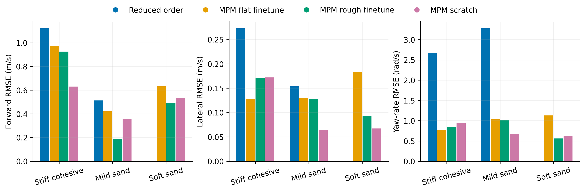
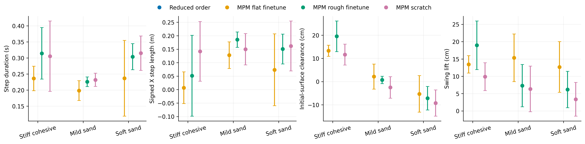
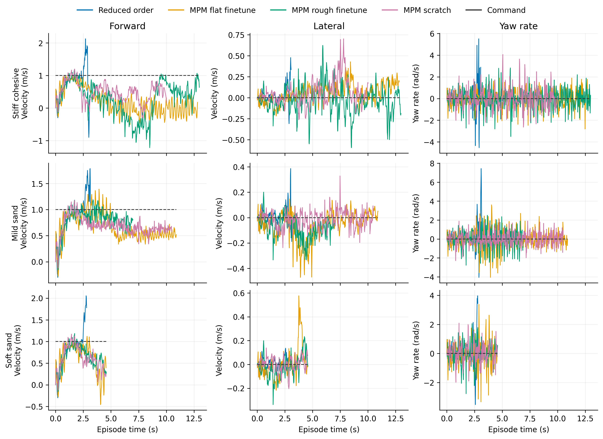

# Ascending

Task: `IsaacContrib-Velocity-Sand-Ascending-G1-29dof-MPM-Play`

One episode per policy/material, seed 42. Early terminations remain included.

| Material | Policy | Outcome | Duration (s) | Sand window (s) | vx RMSE (m/s) | vy RMSE (m/s) | wz RMSE (rad/s) |
|---|---|---|---:|---:|---:|---:|---:|
| Stiff cohesive | Reduced order | Stopped: bad_orientation | 3.080 | 0.300 | 1.122 | 0.273 | 2.668 |
| Stiff cohesive | MPM flat finetune | Stopped: outside_workspace | 12.840 | 10.220 | 0.976 | 0.128 | 0.764 |
| Stiff cohesive | MPM rough finetune | time limit | 13.000 | 8.680 | 0.926 | 0.171 | 0.841 |
| Stiff cohesive | MPM scratch | Stopped: outside_workspace | 10.040 | 7.700 | 0.630 | 0.172 | 0.950 |
| Mild sand | Reduced order | Stopped: base_too_low | 3.180 | 0.400 | 0.513 | 0.154 | 3.279 |
| Mild sand | MPM flat finetune | crossed sand bed | 10.920 | 8.280 | 0.422 | 0.130 | 1.031 |
| Mild sand | MPM rough finetune | Stopped: outside_workspace | 7.000 | 4.520 | 0.190 | 0.128 | 1.022 |
| Mild sand | MPM scratch | crossed sand bed | 10.520 | 8.120 | 0.355 | 0.064 | 0.674 |
| Soft sand | Reduced order | Stopped: bad_orientation | 2.820 | 0.000 | — | — | — |
| Soft sand | MPM flat finetune | solver capacity error | 4.580 | 1.900 | 0.631 | 0.183 | 1.128 |
| Soft sand | MPM rough finetune | solver capacity error | 4.600 | 1.960 | 0.490 | 0.092 | 0.564 |
| Soft sand | MPM scratch | solver capacity error | 4.580 | 2.080 | 0.533 | 0.067 | 0.618 |

[Tracking PDF](tracking.pdf)

| Material | Policy | Steps / swings | Step duration (s) | Signed X step length (m) | Clearance (cm) | Swing lift (cm) |
|---|---|---:|---:|---:|---:|---:|
| Stiff cohesive | Reduced order | 0 / 0 | — | — | — | — |
| Stiff cohesive | MPM flat finetune | 42 / 42 | 0.236 ± 0.038 | 0.007 ± 0.059 | 13.285 ± 2.390 | 13.434 ± 2.497 |
| Stiff cohesive | MPM rough finetune | 25 / 25 | 0.314 ± 0.080 | 0.051 ± 0.150 | 19.525 ± 6.605 | 18.944 ± 7.014 |
| Stiff cohesive | MPM scratch | 22 / 23 | 0.305 ± 0.110 | 0.142 ± 0.111 | 11.632 ± 4.502 | 9.890 ± 4.018 |
| Mild sand | Reduced order | 0 / 0 | — | — | — | — |
| Mild sand | MPM flat finetune | 39 / 40 | 0.198 ± 0.031 | 0.128 ± 0.049 | 2.149 ± 5.386 | 15.331 ± 6.874 |
| Mild sand | MPM rough finetune | 17 / 18 | 0.226 ± 0.015 | 0.185 ± 0.029 | 0.718 ± 1.596 | 7.278 ± 6.106 |
| Mild sand | MPM scratch | 32 / 33 | 0.232 ± 0.021 | 0.150 ± 0.058 | -2.512 ± 4.649 | 6.342 ± 6.582 |
| Soft sand | Reduced order | 0 / 0 | — | — | — | — |
| Soft sand | MPM flat finetune | 6 / 7 | 0.237 ± 0.118 | 0.073 ± 0.133 | -5.308 ± 7.879 | 12.682 ± 7.330 |
| Soft sand | MPM rough finetune | 5 / 5 | 0.304 ± 0.041 | 0.151 ± 0.055 | -7.163 ± 5.082 | 6.172 ± 5.244 |
| Soft sand | MPM scratch | 4 / 5 | 0.315 ± 0.054 | 0.162 ± 0.093 | -9.269 ± 5.645 | 3.354 ± 4.869 |

[Gait PDF](gait.pdf)

[Traces PDF](traces.pdf)

Gait bars show variation between events in one rollout, not uncertainty across seeds. Clearance uses the initial surface, not the deformed particle surface. Signed X steps can be negative during backward motion and do not measure lateral step length. Missing points mean no complete eligible event.

## Videos

- [basalt_like: 1×4 comparison](../../../videos/four_policy_20261022/ascending/comparison_basalt_like.mp4)
  - [Reduced order](../../../videos/four_policy_20261022/ascending/basalt_like__soft_contact__seed42/rollout.mp4) · [raw data](basalt_like__soft_contact__seed42/trace.npz) · [events](basalt_like__soft_contact__seed42/gait_events.json)
  - [MPM flat finetune](../../../videos/four_policy_20261022/ascending/basalt_like__mpm_flat__seed42/rollout.mp4) · [raw data](basalt_like__mpm_flat__seed42/trace.npz) · [events](basalt_like__mpm_flat__seed42/gait_events.json)
  - [MPM rough finetune](../../../videos/four_policy_20261022/ascending/basalt_like__mpm_rough__seed42/rollout.mp4) · [raw data](basalt_like__mpm_rough__seed42/trace.npz) · [events](basalt_like__mpm_rough__seed42/gait_events.json)
  - [MPM scratch](../../../videos/four_policy_20261022/ascending/basalt_like__scratch__seed42/rollout.mp4) · [raw data](basalt_like__scratch__seed42/trace.npz) · [events](basalt_like__scratch__seed42/gait_events.json)
- [mild_sand: 1×4 comparison](../../../videos/four_policy_20261022/ascending/comparison_mild_sand.mp4)
  - [Reduced order](../../../videos/four_policy_20261022/ascending/mild_sand__soft_contact__seed42/rollout.mp4) · [raw data](mild_sand__soft_contact__seed42/trace.npz) · [events](mild_sand__soft_contact__seed42/gait_events.json)
  - [MPM flat finetune](../../../videos/four_policy_20261022/ascending/mild_sand__mpm_flat__seed42/rollout.mp4) · [raw data](mild_sand__mpm_flat__seed42/trace.npz) · [events](mild_sand__mpm_flat__seed42/gait_events.json)
  - [MPM rough finetune](../../../videos/four_policy_20261022/ascending/mild_sand__mpm_rough__seed42/rollout.mp4) · [raw data](mild_sand__mpm_rough__seed42/trace.npz) · [events](mild_sand__mpm_rough__seed42/gait_events.json)
  - [MPM scratch](../../../videos/four_policy_20261022/ascending/mild_sand__scratch__seed42/rollout.mp4) · [raw data](mild_sand__scratch__seed42/trace.npz) · [events](mild_sand__scratch__seed42/gait_events.json)
- [soft_sand: 1×4 comparison](../../../videos/four_policy_20261022/ascending/comparison_soft_sand.mp4)
  - [Reduced order](../../../videos/four_policy_20261022/ascending/soft_sand__soft_contact__seed42/rollout.mp4) · [raw data](soft_sand__soft_contact__seed42/trace.npz) · [events](soft_sand__soft_contact__seed42/gait_events.json)
  - [MPM flat finetune](../../../videos/four_policy_20261022/ascending/soft_sand__mpm_flat__seed42/rollout.mp4) · [raw data](soft_sand__mpm_flat__seed42/trace.npz) · [events](soft_sand__mpm_flat__seed42/gait_events.json)
  - [MPM rough finetune](../../../videos/four_policy_20261022/ascending/soft_sand__mpm_rough__seed42/rollout.mp4) · [raw data](soft_sand__mpm_rough__seed42/trace.npz) · [events](soft_sand__mpm_rough__seed42/gait_events.json)
  - [MPM scratch](../../../videos/four_policy_20261022/ascending/soft_sand__scratch__seed42/rollout.mp4) · [raw data](soft_sand__scratch__seed42/trace.npz) · [events](soft_sand__scratch__seed42/gait_events.json)
