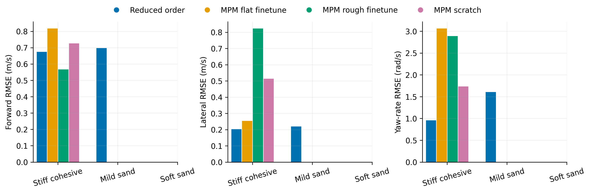
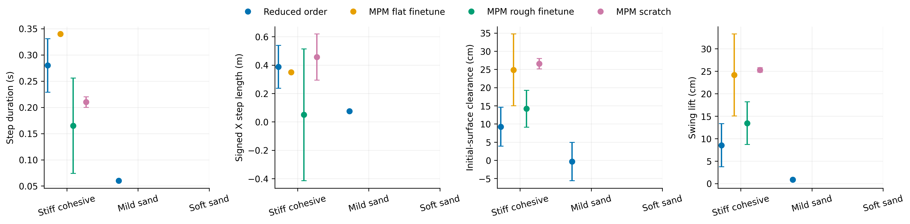
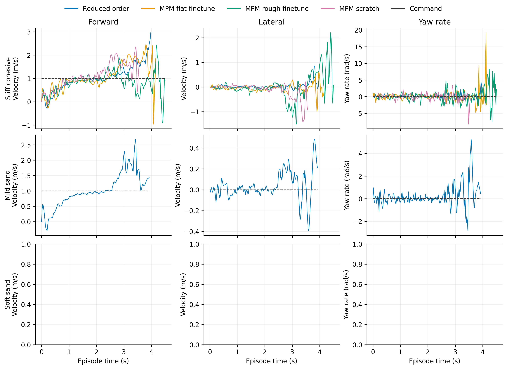

# Descending

Task: `IsaacContrib-Velocity-Sand-Descending-G1-29dof-MPM-Play`

One episode per policy/material, seed 42. Early terminations remain included.

| Material | Policy | Outcome | Duration (s) | Sand window (s) | vx RMSE (m/s) | vy RMSE (m/s) | wz RMSE (rad/s) |
|---|---|---|---:|---:|---:|---:|---:|
| Stiff cohesive | Reduced order | Stopped: bad_orientation | 4.000 | 1.440 | 0.674 | 0.203 | 0.957 |
| Stiff cohesive | MPM flat finetune | Stopped: bad_orientation | 4.180 | 1.560 | 0.818 | 0.254 | 3.063 |
| Stiff cohesive | MPM rough finetune | Stopped: extreme_action | 4.520 | 1.520 | 0.567 | 0.823 | 2.888 |
| Stiff cohesive | MPM scratch | Stopped: bad_orientation | 3.580 | 1.280 | 0.726 | 0.513 | 1.735 |
| Mild sand | Reduced order | Stopped: bad_orientation | 3.940 | 1.400 | 0.698 | 0.220 | 1.605 |

[Tracking PDF](tracking.pdf)

| Material | Policy | Steps / swings | Step duration (s) | Signed X step length (m) | Clearance (cm) | Swing lift (cm) |
|---|---|---:|---:|---:|---:|---:|
| Stiff cohesive | Reduced order | 4 / 4 | 0.280 ± 0.051 | 0.387 ± 0.151 | 9.250 ± 5.344 | 8.529 ± 4.805 |
| Stiff cohesive | MPM flat finetune | 1 / 2 | 0.340 ± 0.000 | 0.349 ± 0.000 | 24.881 ± 9.878 | 24.166 ± 9.128 |
| Stiff cohesive | MPM rough finetune | 4 / 2 | 0.165 ± 0.091 | 0.050 ± 0.465 | 14.185 ± 5.069 | 13.444 ± 4.731 |
| Stiff cohesive | MPM scratch | 2 / 2 | 0.210 ± 0.010 | 0.457 ± 0.163 | 26.578 ± 1.413 | 25.294 ± 0.505 |
| Mild sand | Reduced order | 1 / 2 | 0.060 ± 0.000 | 0.075 ± 0.000 | -0.347 ± 5.276 | 0.884 ± 0.262 |

[Gait PDF](gait.pdf)

[Traces PDF](traces.pdf)

Gait bars show variation between events in one rollout, not uncertainty across seeds. Clearance uses the initial surface, not the deformed particle surface. Signed X steps can be negative during backward motion and do not measure lateral step length. Missing points mean no complete eligible event.

## Videos

- [basalt_like: 1×4 comparison](../../../videos/four_policy_20261022/descending/comparison_basalt_like.mp4)
  - [Reduced order](../../../videos/four_policy_20261022/descending/basalt_like__soft_contact__seed42/rollout.mp4) · [raw data](basalt_like__soft_contact__seed42/trace.npz) · [events](basalt_like__soft_contact__seed42/gait_events.json)
  - [MPM flat finetune](../../../videos/four_policy_20261022/descending/basalt_like__mpm_flat__seed42/rollout.mp4) · [raw data](basalt_like__mpm_flat__seed42/trace.npz) · [events](basalt_like__mpm_flat__seed42/gait_events.json)
  - [MPM rough finetune](../../../videos/four_policy_20261022/descending/basalt_like__mpm_rough__seed42/rollout.mp4) · [raw data](basalt_like__mpm_rough__seed42/trace.npz) · [events](basalt_like__mpm_rough__seed42/gait_events.json)
  - [MPM scratch](../../../videos/four_policy_20261022/descending/basalt_like__scratch__seed42/rollout.mp4) · [raw data](basalt_like__scratch__seed42/trace.npz) · [events](basalt_like__scratch__seed42/gait_events.json)
- [mild_sand: 1×4 comparison](../../../videos/four_policy_20261022/descending/comparison_mild_sand.mp4)
  - [Reduced order](../../../videos/four_policy_20261022/descending/mild_sand__soft_contact__seed42/rollout.mp4) · [raw data](mild_sand__soft_contact__seed42/trace.npz) · [events](mild_sand__soft_contact__seed42/gait_events.json)
  - [MPM flat finetune](../../../videos/four_policy_20261022/descending/mild_sand__mpm_flat__seed42/rollout.mp4) · [raw data](mild_sand__mpm_flat__seed42/trace.npz) · [events](mild_sand__mpm_flat__seed42/gait_events.json)
  - [MPM rough finetune](../../../videos/four_policy_20261022/descending/mild_sand__mpm_rough__seed42/rollout.mp4) · [raw data](mild_sand__mpm_rough__seed42/trace.npz) · [events](mild_sand__mpm_rough__seed42/gait_events.json)
  - [MPM scratch](../../../videos/four_policy_20261022/descending/mild_sand__scratch__seed42/rollout.mp4) · [raw data](mild_sand__scratch__seed42/trace.npz) · [events](mild_sand__scratch__seed42/gait_events.json)
- [soft_sand: 1×4 comparison](../../../videos/four_policy_20261022/descending/comparison_soft_sand.mp4)
  - [Reduced order](../../../videos/four_policy_20261022/descending/soft_sand__soft_contact__seed42/rollout.mp4) · [raw data](soft_sand__soft_contact__seed42/trace.npz) · [events](soft_sand__soft_contact__seed42/gait_events.json)
  - [MPM flat finetune](../../../videos/four_policy_20261022/descending/soft_sand__mpm_flat__seed42/rollout.mp4) · [raw data](soft_sand__mpm_flat__seed42/trace.npz) · [events](soft_sand__mpm_flat__seed42/gait_events.json)
  - [MPM rough finetune](../../../videos/four_policy_20261022/descending/soft_sand__mpm_rough__seed42/rollout.mp4) · [raw data](soft_sand__mpm_rough__seed42/trace.npz) · [events](soft_sand__mpm_rough__seed42/gait_events.json)
  - [MPM scratch](../../../videos/four_policy_20261022/descending/soft_sand__scratch__seed42/rollout.mp4) · [raw data](soft_sand__scratch__seed42/trace.npz) · [events](soft_sand__scratch__seed42/gait_events.json)
