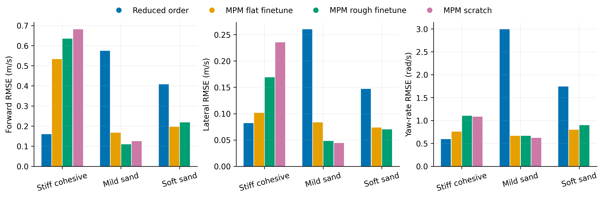
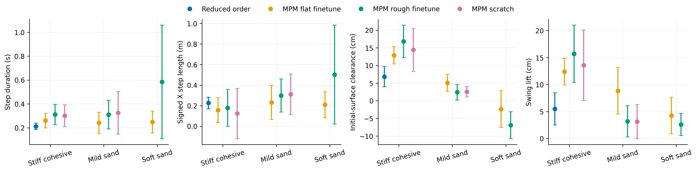
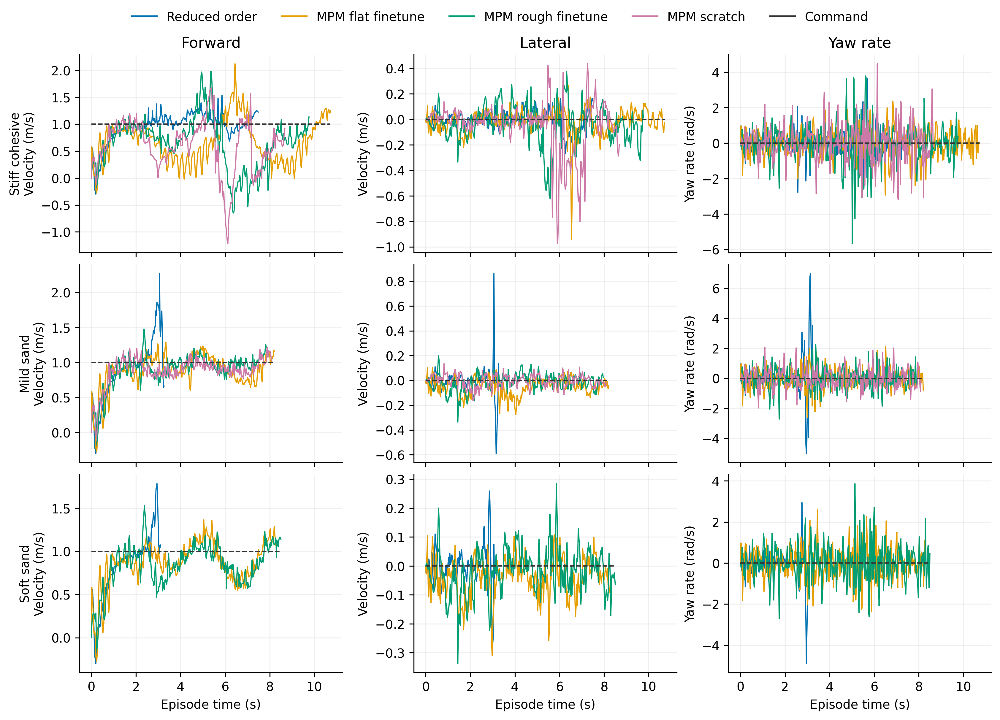

# Dune

Task: `IsaacContrib-Velocity-Sand-Dune-G1-29dof-MPM-Play`

One episode per policy/material, seed 42. Early terminations remain included.

| Material | Policy | Outcome | Duration (s) | Sand window (s) | vx RMSE (m/s) | vy RMSE (m/s) | wz RMSE (rad/s) |
|---|---|---|---:|---:|---:|---:|---:|
| Stiff cohesive | Reduced order | crossed sand bed | 7.500 | 4.840 | 0.160 | 0.082 | 0.593 |
| Stiff cohesive | MPM flat finetune | crossed sand bed | 10.740 | 8.120 | 0.533 | 0.101 | 0.758 |
| Stiff cohesive | MPM rough finetune | Stopped: outside_workspace | 9.780 | 7.240 | 0.635 | 0.169 | 1.105 |
| Stiff cohesive | MPM scratch | Stopped: outside_workspace | 8.700 | 6.060 | 0.682 | 0.235 | 1.083 |
| Mild sand | Reduced order | Stopped: bad_orientation | 3.280 | 0.660 | 0.574 | 0.260 | 2.993 |
| Mild sand | MPM flat finetune | crossed sand bed | 8.220 | 5.600 | 0.167 | 0.083 | 0.665 |
| Mild sand | MPM rough finetune | crossed sand bed | 7.980 | 5.540 | 0.109 | 0.048 | 0.664 |
| Mild sand | MPM scratch | crossed sand bed | 8.120 | 5.780 | 0.125 | 0.044 | 0.620 |
| Soft sand | Reduced order | Stopped: bad_orientation | 3.120 | 0.440 | 0.407 | 0.147 | 1.743 |
| Soft sand | MPM flat finetune | crossed sand bed | 8.280 | 5.660 | 0.197 | 0.074 | 0.797 |
| Soft sand | MPM rough finetune | crossed sand bed | 8.520 | 6.080 | 0.218 | 0.070 | 0.900 |

[Tracking PDF](tracking.pdf)

| Material | Policy | Steps / swings | Step duration (s) | Signed X step length (m) | Clearance (cm) | Swing lift (cm) |
|---|---|---:|---:|---:|---:|---:|
| Stiff cohesive | Reduced order | 21 / 21 | 0.212 ± 0.028 | 0.226 ± 0.057 | 6.813 ± 2.874 | 5.476 ± 2.989 |
| Stiff cohesive | MPM flat finetune | 28 / 29 | 0.261 ± 0.061 | 0.156 ± 0.122 | 12.867 ± 2.457 | 12.404 ± 2.488 |
| Stiff cohesive | MPM rough finetune | 22 / 22 | 0.312 ± 0.085 | 0.179 ± 0.180 | 16.824 ± 4.622 | 15.689 ± 5.335 |
| Stiff cohesive | MPM scratch | 15 / 16 | 0.301 ± 0.091 | 0.123 ± 0.245 | 14.414 ± 6.052 | 13.570 ± 6.528 |
| Mild sand | Reduced order | 0 / 0 | — | — | — | — |
| Mild sand | MPM flat finetune | 21 / 21 | 0.242 ± 0.089 | 0.231 ± 0.165 | 5.078 ± 2.397 | 8.838 ± 4.316 |
| Mild sand | MPM rough finetune | 17 / 17 | 0.311 ± 0.120 | 0.299 ± 0.161 | 2.394 ± 2.200 | 3.176 ± 2.894 |
| Mild sand | MPM scratch | 15 / 16 | 0.325 ± 0.178 | 0.310 ± 0.197 | 2.557 ± 1.498 | 3.118 ± 3.170 |
| Soft sand | Reduced order | 0 / 0 | — | — | — | — |
| Soft sand | MPM flat finetune | 16 / 18 | 0.249 ± 0.092 | 0.210 ± 0.126 | -2.387 ± 5.238 | 4.252 ± 3.379 |
| Soft sand | MPM rough finetune | 9 / 9 | 0.584 ± 0.476 | 0.503 ± 0.482 | -6.937 ± 3.838 | 2.596 ± 2.044 |

[Gait PDF](gait.pdf)

[Traces PDF](traces.pdf)

Gait bars show variation between events in one rollout, not uncertainty across seeds. Clearance uses the initial surface, not the deformed particle surface. Signed X steps can be negative during backward motion and do not measure lateral step length. Missing points mean no complete eligible event.

## Videos

- [basalt_like: 1×4 comparison](../../../videos/four_policy_20261022/dune/comparison_basalt_like.mp4)
  - [Reduced order](../../../videos/four_policy_20261022/dune/basalt_like__soft_contact__seed42/rollout.mp4) · [raw data](basalt_like__soft_contact__seed42/trace.npz) · [events](basalt_like__soft_contact__seed42/gait_events.json)
  - [MPM flat finetune](../../../videos/four_policy_20261022/dune/basalt_like__mpm_flat__seed42/rollout.mp4) · [raw data](basalt_like__mpm_flat__seed42/trace.npz) · [events](basalt_like__mpm_flat__seed42/gait_events.json)
  - [MPM rough finetune](../../../videos/four_policy_20261022/dune/basalt_like__mpm_rough__seed42/rollout.mp4) · [raw data](basalt_like__mpm_rough__seed42/trace.npz) · [events](basalt_like__mpm_rough__seed42/gait_events.json)
  - [MPM scratch](../../../videos/four_policy_20261022/dune/basalt_like__scratch__seed42/rollout.mp4) · [raw data](basalt_like__scratch__seed42/trace.npz) · [events](basalt_like__scratch__seed42/gait_events.json)
- [mild_sand: 1×4 comparison](../../../videos/four_policy_20261022/dune/comparison_mild_sand.mp4)
  - [Reduced order](../../../videos/four_policy_20261022/dune/mild_sand__soft_contact__seed42/rollout.mp4) · [raw data](mild_sand__soft_contact__seed42/trace.npz) · [events](mild_sand__soft_contact__seed42/gait_events.json)
  - [MPM flat finetune](../../../videos/four_policy_20261022/dune/mild_sand__mpm_flat__seed42/rollout.mp4) · [raw data](mild_sand__mpm_flat__seed42/trace.npz) · [events](mild_sand__mpm_flat__seed42/gait_events.json)
  - [MPM rough finetune](../../../videos/four_policy_20261022/dune/mild_sand__mpm_rough__seed42/rollout.mp4) · [raw data](mild_sand__mpm_rough__seed42/trace.npz) · [events](mild_sand__mpm_rough__seed42/gait_events.json)
  - [MPM scratch](../../../videos/four_policy_20261022/dune/mild_sand__scratch__seed42/rollout.mp4) · [raw data](mild_sand__scratch__seed42/trace.npz) · [events](mild_sand__scratch__seed42/gait_events.json)
- [soft_sand: 1×4 comparison](../../../videos/four_policy_20261022/dune/comparison_soft_sand.mp4)
  - [Reduced order](../../../videos/four_policy_20261022/dune/soft_sand__soft_contact__seed42/rollout.mp4) · [raw data](soft_sand__soft_contact__seed42/trace.npz) · [events](soft_sand__soft_contact__seed42/gait_events.json)
  - [MPM flat finetune](../../../videos/four_policy_20261022/dune/soft_sand__mpm_flat__seed42/rollout.mp4) · [raw data](soft_sand__mpm_flat__seed42/trace.npz) · [events](soft_sand__mpm_flat__seed42/gait_events.json)
  - [MPM rough finetune](../../../videos/four_policy_20261022/dune/soft_sand__mpm_rough__seed42/rollout.mp4) · [raw data](soft_sand__mpm_rough__seed42/trace.npz) · [events](soft_sand__mpm_rough__seed42/gait_events.json)
  - [MPM scratch](../../../videos/four_policy_20261022/dune/soft_sand__scratch__seed42/rollout.mp4) · [raw data](soft_sand__scratch__seed42/trace.npz) · [events](soft_sand__scratch__seed42/gait_events.json)
