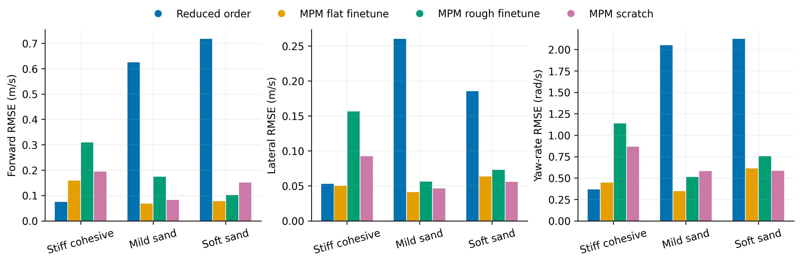
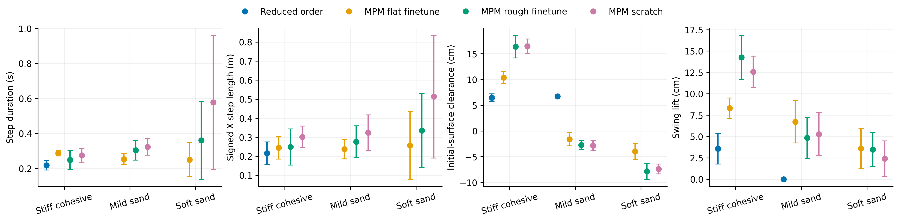
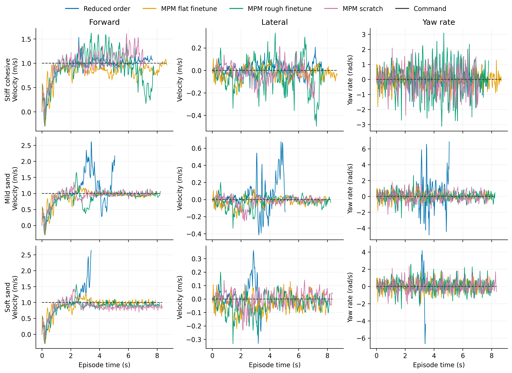

# Flat

Task: `IsaacContrib-Velocity-Sand-Flat-G1-29dof-MPM-Play`

One episode per policy/material, seed 42. Early terminations remain included.

| Material | Policy | Outcome | Duration (s) | Sand window (s) | vx RMSE (m/s) | vy RMSE (m/s) | wz RMSE (rad/s) |
|---|---|---|---:|---:|---:|---:|---:|
| Stiff cohesive | Reduced order | crossed sand bed | 7.700 | 5.060 | 0.075 | 0.053 | 0.367 |
| Stiff cohesive | MPM flat finetune | crossed sand bed | 8.700 | 6.080 | 0.158 | 0.050 | 0.448 |
| Stiff cohesive | MPM rough finetune | crossed sand bed | 7.820 | 5.320 | 0.309 | 0.156 | 1.136 |
| Stiff cohesive | MPM scratch | crossed sand bed | 7.160 | 4.820 | 0.194 | 0.092 | 0.866 |
| Mild sand | Reduced order | Stopped: outside_workspace | 5.080 | 2.560 | 0.625 | 0.260 | 2.049 |
| Mild sand | MPM flat finetune | crossed sand bed | 8.040 | 5.420 | 0.068 | 0.041 | 0.346 |
| Mild sand | MPM rough finetune | crossed sand bed | 8.260 | 5.820 | 0.174 | 0.056 | 0.511 |
| Mild sand | MPM scratch | crossed sand bed | 7.780 | 5.480 | 0.082 | 0.046 | 0.580 |
| Soft sand | Reduced order | Stopped: bad_orientation | 3.440 | 0.900 | 0.718 | 0.185 | 2.124 |
| Soft sand | MPM flat finetune | crossed sand bed | 7.920 | 5.300 | 0.077 | 0.064 | 0.611 |
| Soft sand | MPM rough finetune | crossed sand bed | 8.200 | 5.760 | 0.101 | 0.073 | 0.754 |
| Soft sand | MPM scratch | crossed sand bed | 8.380 | 6.080 | 0.151 | 0.056 | 0.583 |

[Tracking PDF](tracking.pdf)

| Material | Policy | Steps / swings | Step duration (s) | Signed X step length (m) | Clearance (cm) | Swing lift (cm) |
|---|---|---:|---:|---:|---:|---:|
| Stiff cohesive | Reduced order | 22 / 22 | 0.217 ± 0.027 | 0.217 ± 0.059 | 6.432 ± 0.775 | 3.553 ± 1.777 |
| Stiff cohesive | MPM flat finetune | 20 / 20 | 0.286 ± 0.016 | 0.245 ± 0.060 | 10.356 ± 1.185 | 8.311 ± 1.189 |
| Stiff cohesive | MPM rough finetune | 19 / 19 | 0.248 ± 0.055 | 0.249 ± 0.095 | 16.377 ± 2.203 | 14.251 ± 2.600 |
| Stiff cohesive | MPM scratch | 17 / 16 | 0.274 ± 0.039 | 0.302 ± 0.057 | 16.444 ± 1.417 | 12.563 ± 1.835 |
| Mild sand | Reduced order | 0 / 1 | — | — | 6.709 ± 0.000 | 0.000 ± 0.000 |
| Mild sand | MPM flat finetune | 18 / 19 | 0.253 ± 0.031 | 0.238 ± 0.051 | -1.633 ± 1.282 | 6.722 ± 2.493 |
| Mild sand | MPM rough finetune | 18 / 17 | 0.303 ± 0.057 | 0.276 ± 0.083 | -2.731 ± 0.933 | 4.854 ± 2.414 |
| Mild sand | MPM scratch | 16 / 16 | 0.323 ± 0.047 | 0.324 ± 0.093 | -2.850 ± 0.937 | 5.286 ± 2.535 |
| Soft sand | Reduced order | 0 / 0 | — | — | — | — |
| Soft sand | MPM flat finetune | 20 / 20 | 0.250 ± 0.096 | 0.257 ± 0.177 | -3.973 ± 1.594 | 3.598 ± 2.325 |
| Soft sand | MPM rough finetune | 10 / 13 | 0.360 ± 0.222 | 0.335 ± 0.194 | -7.810 ± 1.561 | 3.467 ± 2.005 |
| Soft sand | MPM scratch | 7 / 10 | 0.577 ± 0.384 | 0.513 ± 0.323 | -7.376 ± 0.966 | 2.414 ± 2.072 |

[Gait PDF](gait.pdf)

[Traces PDF](traces.pdf)

Gait bars show variation between events in one rollout, not uncertainty across seeds. Clearance uses the initial surface, not the deformed particle surface. Signed X steps can be negative during backward motion and do not measure lateral step length. Missing points mean no complete eligible event.

## Videos

- [basalt_like: 1×4 comparison](../../../videos/four_policy_20261022/flat/comparison_basalt_like.mp4)
  - [Reduced order](../../../videos/four_policy_20261022/flat/basalt_like__soft_contact__seed42/rollout.mp4) · [raw data](basalt_like__soft_contact__seed42/trace.npz) · [events](basalt_like__soft_contact__seed42/gait_events.json)
  - [MPM flat finetune](../../../videos/four_policy_20261022/flat/basalt_like__mpm_flat__seed42/rollout.mp4) · [raw data](basalt_like__mpm_flat__seed42/trace.npz) · [events](basalt_like__mpm_flat__seed42/gait_events.json)
  - [MPM rough finetune](../../../videos/four_policy_20261022/flat/basalt_like__mpm_rough__seed42/rollout.mp4) · [raw data](basalt_like__mpm_rough__seed42/trace.npz) · [events](basalt_like__mpm_rough__seed42/gait_events.json)
  - [MPM scratch](../../../videos/four_policy_20261022/flat/basalt_like__scratch__seed42/rollout.mp4) · [raw data](basalt_like__scratch__seed42/trace.npz) · [events](basalt_like__scratch__seed42/gait_events.json)
- [mild_sand: 1×4 comparison](../../../videos/four_policy_20261022/flat/comparison_mild_sand.mp4)
  - [Reduced order](../../../videos/four_policy_20261022/flat/mild_sand__soft_contact__seed42/rollout.mp4) · [raw data](mild_sand__soft_contact__seed42/trace.npz) · [events](mild_sand__soft_contact__seed42/gait_events.json)
  - [MPM flat finetune](../../../videos/four_policy_20261022/flat/mild_sand__mpm_flat__seed42/rollout.mp4) · [raw data](mild_sand__mpm_flat__seed42/trace.npz) · [events](mild_sand__mpm_flat__seed42/gait_events.json)
  - [MPM rough finetune](../../../videos/four_policy_20261022/flat/mild_sand__mpm_rough__seed42/rollout.mp4) · [raw data](mild_sand__mpm_rough__seed42/trace.npz) · [events](mild_sand__mpm_rough__seed42/gait_events.json)
  - [MPM scratch](../../../videos/four_policy_20261022/flat/mild_sand__scratch__seed42/rollout.mp4) · [raw data](mild_sand__scratch__seed42/trace.npz) · [events](mild_sand__scratch__seed42/gait_events.json)
- [soft_sand: 1×4 comparison](../../../videos/four_policy_20261022/flat/comparison_soft_sand.mp4)
  - [Reduced order](../../../videos/four_policy_20261022/flat/soft_sand__soft_contact__seed42/rollout.mp4) · [raw data](soft_sand__soft_contact__seed42/trace.npz) · [events](soft_sand__soft_contact__seed42/gait_events.json)
  - [MPM flat finetune](../../../videos/four_policy_20261022/flat/soft_sand__mpm_flat__seed42/rollout.mp4) · [raw data](soft_sand__mpm_flat__seed42/trace.npz) · [events](soft_sand__mpm_flat__seed42/gait_events.json)
  - [MPM rough finetune](../../../videos/four_policy_20261022/flat/soft_sand__mpm_rough__seed42/rollout.mp4) · [raw data](soft_sand__mpm_rough__seed42/trace.npz) · [events](soft_sand__mpm_rough__seed42/gait_events.json)
  - [MPM scratch](../../../videos/four_policy_20261022/flat/soft_sand__scratch__seed42/rollout.mp4) · [raw data](soft_sand__scratch__seed42/trace.npz) · [events](soft_sand__scratch__seed42/gait_events.json)
