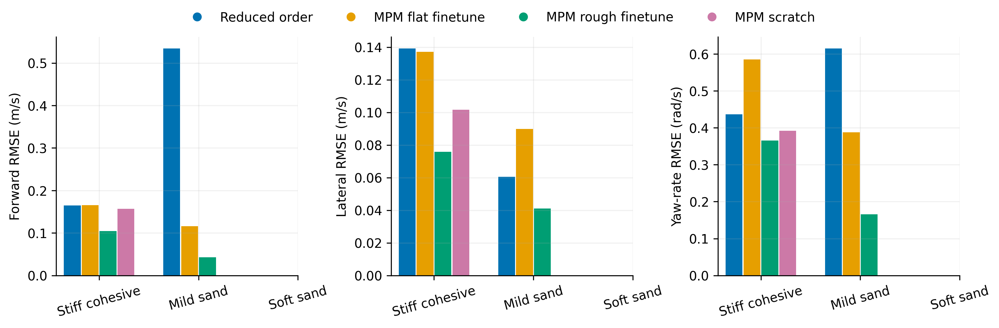
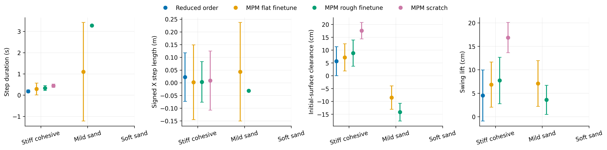
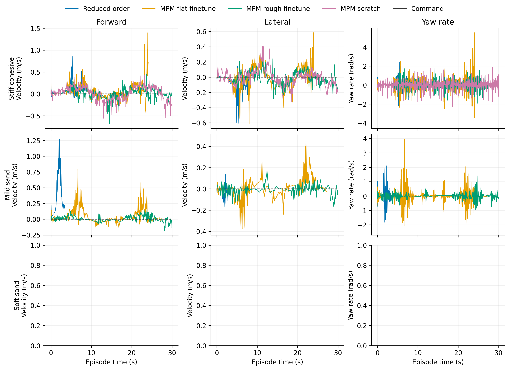

# Standing Tilt

Task: `IsaacContrib-Balance-Sand-Tilting-G1-29dof-MPM-Play`

One episode per policy/material, seed 42. Early terminations remain included.

| Material | Policy | Outcome | Duration (s) | Sand window (s) | vx RMSE (m/s) | vy RMSE (m/s) | wz RMSE (rad/s) |
|---|---|---|---:|---:|---:|---:|---:|
| Stiff cohesive | Reduced order | Stopped: outside_workspace | 8.960 | 8.460 | 0.164 | 0.139 | 0.437 |
| Stiff cohesive | MPM flat finetune | Stopped: outside_workspace | 24.100 | 23.300 | 0.165 | 0.137 | 0.585 |
| Stiff cohesive | MPM rough finetune | time limit | 30.000 | 29.500 | 0.105 | 0.076 | 0.366 |
| Stiff cohesive | MPM scratch | time limit | 30.000 | 29.500 | 0.157 | 0.102 | 0.392 |
| Mild sand | Reduced order | Stopped: outside_workspace | 3.380 | 2.880 | 0.535 | 0.061 | 0.615 |
| Mild sand | MPM flat finetune | Stopped: outside_workspace | 27.320 | 26.600 | 0.116 | 0.090 | 0.388 |
| Mild sand | MPM rough finetune | time limit | 30.000 | 29.500 | 0.043 | 0.041 | 0.166 |

[Tracking PDF](tracking.pdf)

| Material | Policy | Steps / swings | Step duration (s) | Signed X step length (m) | Clearance (cm) | Swing lift (cm) |
|---|---|---:|---:|---:|---:|---:|
| Stiff cohesive | Reduced order | 19 / 22 | 0.180 ± 0.067 | 0.022 ± 0.096 | 5.656 ± 5.670 | 4.511 ± 5.441 |
| Stiff cohesive | MPM flat finetune | 57 / 61 | 0.289 ± 0.277 | 0.002 ± 0.147 | 7.147 ± 5.290 | 6.827 ± 4.822 |
| Stiff cohesive | MPM rough finetune | 57 / 64 | 0.334 ± 0.115 | 0.003 ± 0.080 | 8.808 ± 5.117 | 7.709 ± 4.947 |
| Stiff cohesive | MPM scratch | 65 / 65 | 0.444 ± 0.080 | 0.009 ± 0.116 | 17.549 ± 3.215 | 16.858 ± 3.226 |
| Mild sand | Reduced order | 0 / 0 | — | — | — | — |
| Mild sand | MPM flat finetune | 15 / 19 | 1.101 ± 2.320 | 0.043 ± 0.194 | -8.532 ± 4.569 | 7.070 ± 4.887 |
| Mild sand | MPM rough finetune | 1 / 5 | 3.280 ± 0.000 | -0.031 ± 0.000 | -14.202 ± 3.467 | 3.584 ± 3.114 |

[Gait PDF](gait.pdf)

[Traces PDF](traces.pdf)

Gait bars show variation between events in one rollout, not uncertainty across seeds. Clearance uses the initial surface, not the deformed particle surface. Signed X steps can be negative during backward motion and do not measure lateral step length. Missing points mean no complete eligible event.

## Videos

- [basalt_like: 1×4 comparison](../../../videos/four_policy_20261022/standing_tilt/comparison_basalt_like.mp4)
  - [Reduced order](../../../videos/four_policy_20261022/standing_tilt/basalt_like__soft_contact__seed42/rollout.mp4) · [raw data](basalt_like__soft_contact__seed42/trace.npz) · [events](basalt_like__soft_contact__seed42/gait_events.json)
  - [MPM flat finetune](../../../videos/four_policy_20261022/standing_tilt/basalt_like__mpm_flat__seed42/rollout.mp4) · [raw data](basalt_like__mpm_flat__seed42/trace.npz) · [events](basalt_like__mpm_flat__seed42/gait_events.json)
  - [MPM rough finetune](../../../videos/four_policy_20261022/standing_tilt/basalt_like__mpm_rough__seed42/rollout.mp4) · [raw data](basalt_like__mpm_rough__seed42/trace.npz) · [events](basalt_like__mpm_rough__seed42/gait_events.json)
  - [MPM scratch](../../../videos/four_policy_20261022/standing_tilt/basalt_like__scratch__seed42/rollout.mp4) · [raw data](basalt_like__scratch__seed42/trace.npz) · [events](basalt_like__scratch__seed42/gait_events.json)
- [mild_sand: 1×4 comparison](../../../videos/four_policy_20261022/standing_tilt/comparison_mild_sand.mp4)
  - [Reduced order](../../../videos/four_policy_20261022/standing_tilt/mild_sand__soft_contact__seed42/rollout.mp4) · [raw data](mild_sand__soft_contact__seed42/trace.npz) · [events](mild_sand__soft_contact__seed42/gait_events.json)
  - [MPM flat finetune](../../../videos/four_policy_20261022/standing_tilt/mild_sand__mpm_flat__seed42/rollout.mp4) · [raw data](mild_sand__mpm_flat__seed42/trace.npz) · [events](mild_sand__mpm_flat__seed42/gait_events.json)
  - [MPM rough finetune](../../../videos/four_policy_20261022/standing_tilt/mild_sand__mpm_rough__seed42/rollout.mp4) · [raw data](mild_sand__mpm_rough__seed42/trace.npz) · [events](mild_sand__mpm_rough__seed42/gait_events.json)
  - [MPM scratch](../../../videos/four_policy_20261022/standing_tilt/mild_sand__scratch__seed42/rollout.mp4) · [raw data](mild_sand__scratch__seed42/trace.npz) · [events](mild_sand__scratch__seed42/gait_events.json)
- [soft_sand: 1×4 comparison](../../../videos/four_policy_20261022/standing_tilt/comparison_soft_sand.mp4)
  - [Reduced order](../../../videos/four_policy_20261022/standing_tilt/soft_sand__soft_contact__seed42/rollout.mp4) · [raw data](soft_sand__soft_contact__seed42/trace.npz) · [events](soft_sand__soft_contact__seed42/gait_events.json)
  - [MPM flat finetune](../../../videos/four_policy_20261022/standing_tilt/soft_sand__mpm_flat__seed42/rollout.mp4) · [raw data](soft_sand__mpm_flat__seed42/trace.npz) · [events](soft_sand__mpm_flat__seed42/gait_events.json)
  - [MPM rough finetune](../../../videos/four_policy_20261022/standing_tilt/soft_sand__mpm_rough__seed42/rollout.mp4) · [raw data](soft_sand__mpm_rough__seed42/trace.npz) · [events](soft_sand__mpm_rough__seed42/gait_events.json)
  - [MPM scratch](../../../videos/four_policy_20261022/standing_tilt/soft_sand__scratch__seed42/rollout.mp4) · [raw data](soft_sand__scratch__seed42/trace.npz) · [events](soft_sand__scratch__seed42/gait_events.json)
