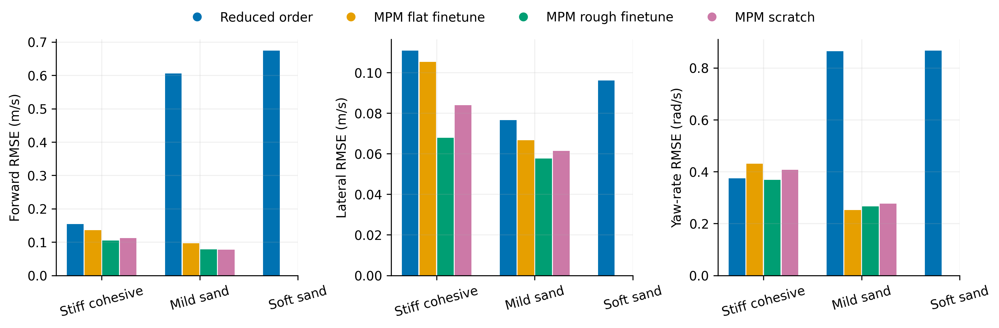
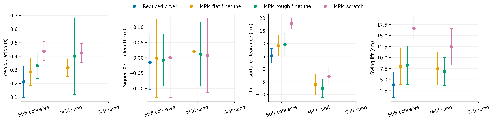
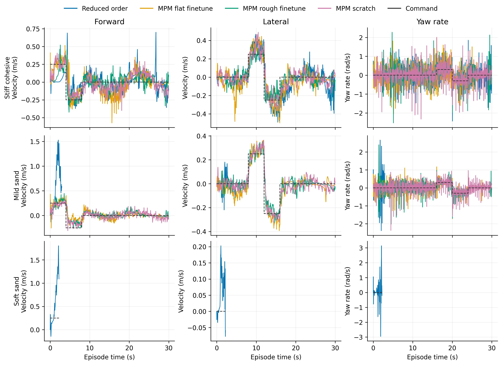

# Walking Tilt

Task: `IsaacContrib-Velocity-Sand-Tilting-G1-29dof-MPM-Play`

One episode per policy/material, seed 42. Early terminations remain included.

| Material | Policy | Outcome | Duration (s) | Sand window (s) | vx RMSE (m/s) | vy RMSE (m/s) | wz RMSE (rad/s) |
|---|---|---|---:|---:|---:|---:|---:|
| Stiff cohesive | Reduced order | time limit | 30.000 | 29.500 | 0.154 | 0.111 | 0.374 |
| Stiff cohesive | MPM flat finetune | time limit | 30.000 | 29.500 | 0.136 | 0.105 | 0.431 |
| Stiff cohesive | MPM rough finetune | time limit | 30.000 | 29.500 | 0.105 | 0.068 | 0.368 |
| Stiff cohesive | MPM scratch | time limit | 30.000 | 29.500 | 0.112 | 0.084 | 0.407 |
| Mild sand | Reduced order | Stopped: outside_workspace | 2.960 | 2.460 | 0.606 | 0.077 | 0.865 |
| Mild sand | MPM flat finetune | time limit | 30.000 | 29.500 | 0.097 | 0.067 | 0.252 |
| Mild sand | MPM rough finetune | time limit | 30.000 | 29.500 | 0.078 | 0.058 | 0.266 |
| Mild sand | MPM scratch | time limit | 30.000 | 29.500 | 0.077 | 0.061 | 0.277 |
| Soft sand | Reduced order | Stopped: bad_orientation | 2.240 | 1.740 | 0.674 | 0.096 | 0.866 |

[Tracking PDF](tracking.pdf)

| Material | Policy | Steps / swings | Step duration (s) | Signed X step length (m) | Clearance (cm) | Swing lift (cm) |
|---|---|---:|---:|---:|---:|---:|
| Stiff cohesive | Reduced order | 98 / 106 | 0.212 ± 0.117 | -0.015 ± 0.089 | 5.145 ± 2.825 | 3.805 ± 2.897 |
| Stiff cohesive | MPM flat finetune | 85 / 88 | 0.286 ± 0.102 | -0.001 ± 0.128 | 9.177 ± 4.150 | 8.018 ± 4.146 |
| Stiff cohesive | MPM rough finetune | 62 / 66 | 0.330 ± 0.095 | -0.008 ± 0.085 | 9.561 ± 4.515 | 8.250 ± 4.359 |
| Stiff cohesive | MPM scratch | 66 / 67 | 0.437 ± 0.069 | 0.000 ± 0.130 | 17.883 ± 2.248 | 16.629 ± 2.416 |
| Mild sand | Reduced order | 0 / 0 | — | — | — | — |
| Mild sand | MPM flat finetune | 51 / 53 | 0.315 ± 0.066 | 0.021 ± 0.096 | -6.149 ± 4.048 | 7.480 ± 3.733 |
| Mild sand | MPM rough finetune | 47 / 50 | 0.401 ± 0.283 | 0.012 ± 0.105 | -7.663 ± 3.630 | 6.861 ± 3.191 |
| Mild sand | MPM scratch | 68 / 68 | 0.424 ± 0.071 | 0.007 ± 0.121 | -3.024 ± 3.334 | 12.442 ± 4.142 |
| Soft sand | Reduced order | 0 / 0 | — | — | — | — |

[Gait PDF](gait.pdf)

[Traces PDF](traces.pdf)

Gait bars show variation between events in one rollout, not uncertainty across seeds. Clearance uses the initial surface, not the deformed particle surface. Signed X steps can be negative during backward motion and do not measure lateral step length. Missing points mean no complete eligible event.

## Videos

- [basalt_like: 1×4 comparison](../../../videos/four_policy_20261022/walking_tilt/comparison_basalt_like.mp4)
  - [Reduced order](../../../videos/four_policy_20261022/walking_tilt/basalt_like__soft_contact__seed42/rollout.mp4) · [raw data](basalt_like__soft_contact__seed42/trace.npz) · [events](basalt_like__soft_contact__seed42/gait_events.json)
  - [MPM flat finetune](../../../videos/four_policy_20261022/walking_tilt/basalt_like__mpm_flat__seed42/rollout.mp4) · [raw data](basalt_like__mpm_flat__seed42/trace.npz) · [events](basalt_like__mpm_flat__seed42/gait_events.json)
  - [MPM rough finetune](../../../videos/four_policy_20261022/walking_tilt/basalt_like__mpm_rough__seed42/rollout.mp4) · [raw data](basalt_like__mpm_rough__seed42/trace.npz) · [events](basalt_like__mpm_rough__seed42/gait_events.json)
  - [MPM scratch](../../../videos/four_policy_20261022/walking_tilt/basalt_like__scratch__seed42/rollout.mp4) · [raw data](basalt_like__scratch__seed42/trace.npz) · [events](basalt_like__scratch__seed42/gait_events.json)
- [mild_sand: 1×4 comparison](../../../videos/four_policy_20261022/walking_tilt/comparison_mild_sand.mp4)
  - [Reduced order](../../../videos/four_policy_20261022/walking_tilt/mild_sand__soft_contact__seed42/rollout.mp4) · [raw data](mild_sand__soft_contact__seed42/trace.npz) · [events](mild_sand__soft_contact__seed42/gait_events.json)
  - [MPM flat finetune](../../../videos/four_policy_20261022/walking_tilt/mild_sand__mpm_flat__seed42/rollout.mp4) · [raw data](mild_sand__mpm_flat__seed42/trace.npz) · [events](mild_sand__mpm_flat__seed42/gait_events.json)
  - [MPM rough finetune](../../../videos/four_policy_20261022/walking_tilt/mild_sand__mpm_rough__seed42/rollout.mp4) · [raw data](mild_sand__mpm_rough__seed42/trace.npz) · [events](mild_sand__mpm_rough__seed42/gait_events.json)
  - [MPM scratch](../../../videos/four_policy_20261022/walking_tilt/mild_sand__scratch__seed42/rollout.mp4) · [raw data](mild_sand__scratch__seed42/trace.npz) · [events](mild_sand__scratch__seed42/gait_events.json)
- [soft_sand: 1×4 comparison](../../../videos/four_policy_20261022/walking_tilt/comparison_soft_sand.mp4)
  - [Reduced order](../../../videos/four_policy_20261022/walking_tilt/soft_sand__soft_contact__seed42/rollout.mp4) · [raw data](soft_sand__soft_contact__seed42/trace.npz) · [events](soft_sand__soft_contact__seed42/gait_events.json)
  - [MPM flat finetune](../../../videos/four_policy_20261022/walking_tilt/soft_sand__mpm_flat__seed42/rollout.mp4) · [raw data](soft_sand__mpm_flat__seed42/trace.npz) · [events](soft_sand__mpm_flat__seed42/gait_events.json)
  - [MPM rough finetune](../../../videos/four_policy_20261022/walking_tilt/soft_sand__mpm_rough__seed42/rollout.mp4) · [raw data](soft_sand__mpm_rough__seed42/trace.npz) · [events](soft_sand__mpm_rough__seed42/gait_events.json)
  - [MPM scratch](../../../videos/four_policy_20261022/walking_tilt/soft_sand__scratch__seed42/rollout.mp4) · [raw data](soft_sand__scratch__seed42/trace.npz) · [events](soft_sand__scratch__seed42/gait_events.json)
