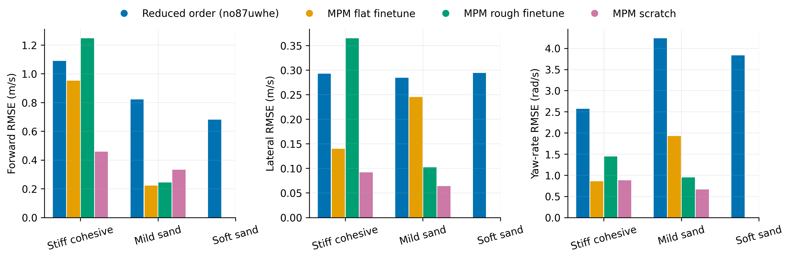
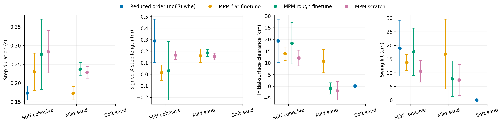
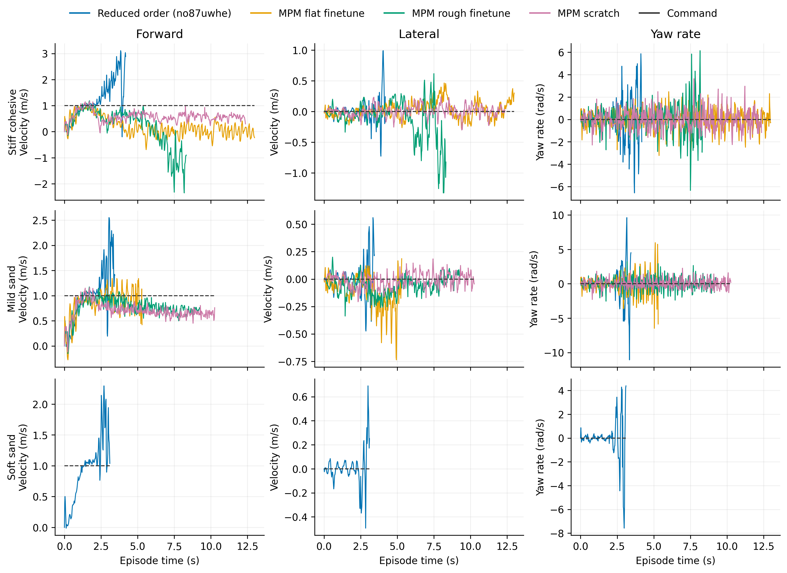

# Ascending

Task: `IsaacContrib-Velocity-Sand-Ascending-G1-29dof-MPM-Play`

One episode per policy/material, seed 42. Early terminations remain included.

| Material | Policy | Outcome | Duration (s) | Sand window (s) | vx RMSE (m/s) | vy RMSE (m/s) | wz RMSE (rad/s) |
|---|---|---|---:|---:|---:|---:|---:|
| Stiff cohesive | Reduced order (no87uwhe) | Stopped: bad_orientation | 4.200 | 1.680 | 1.089 | 0.293 | 2.573 |
| Stiff cohesive | MPM flat finetune | time limit | 13.000 | 10.340 | 0.952 | 0.140 | 0.860 |
| Stiff cohesive | MPM rough finetune | Stopped: outside_workspace | 8.340 | 5.720 | 1.248 | 0.365 | 1.446 |
| Stiff cohesive | MPM scratch | crossed sand bed | 12.380 | 9.640 | 0.458 | 0.092 | 0.881 |
| Mild sand | Reduced order (no87uwhe) | Stopped: bad_orientation | 3.460 | 0.860 | 0.821 | 0.284 | 4.240 |
| Mild sand | MPM flat finetune | Stopped: outside_workspace | 5.320 | 2.680 | 0.221 | 0.245 | 1.925 |
| Mild sand | MPM rough finetune | crossed sand bed | 9.300 | 6.820 | 0.244 | 0.102 | 0.947 |
| Mild sand | MPM scratch | crossed sand bed | 10.280 | 7.860 | 0.332 | 0.064 | 0.666 |
| Soft sand | Reduced order (no87uwhe) | Stopped: bad_orientation | 3.120 | 0.520 | 0.681 | 0.294 | 3.832 |

[Tracking PDF](tracking.pdf)

| Material | Policy | Steps / swings | Step duration (s) | Signed X step length (m) | Clearance (cm) | Swing lift (cm) |
|---|---|---:|---:|---:|---:|---:|
| Stiff cohesive | Reduced order (no87uwhe) | 9 / 9 | 0.173 ± 0.019 | 0.289 ± 0.188 | 19.316 ± 9.262 | 18.960 ± 10.186 |
| Stiff cohesive | MPM flat finetune | 44 / 44 | 0.230 ± 0.049 | 0.013 ± 0.066 | 13.866 ± 2.815 | 13.739 ± 2.877 |
| Stiff cohesive | MPM rough finetune | 18 / 19 | 0.277 ± 0.094 | 0.030 ± 0.254 | 18.353 ± 8.795 | 17.644 ± 8.609 |
| Stiff cohesive | MPM scratch | 32 / 33 | 0.284 ± 0.057 | 0.166 ± 0.037 | 12.049 ± 3.324 | 10.542 ± 3.977 |
| Mild sand | Reduced order (no87uwhe) | 0 / 0 | — | — | — | — |
| Mild sand | MPM flat finetune | 11 / 13 | 0.173 ± 0.018 | 0.161 ± 0.059 | 10.689 ± 4.912 | 16.826 ± 12.721 |
| Mild sand | MPM rough finetune | 28 / 28 | 0.237 ± 0.017 | 0.185 ± 0.031 | -0.921 ± 2.411 | 7.766 ± 6.482 |
| Mild sand | MPM scratch | 33 / 33 | 0.228 ± 0.016 | 0.154 ± 0.028 | -1.952 ± 3.932 | 7.345 ± 5.671 |
| Soft sand | Reduced order (no87uwhe) | 0 / 1 | — | — | 0.149 ± 0.000 | 0.000 ± 0.000 |

[Gait PDF](gait.pdf)

[Traces PDF](traces.pdf)

Gait bars show variation between events in one rollout, not uncertainty across seeds. Clearance uses the initial surface, not the deformed particle surface. Signed X steps can be negative during backward motion and do not measure lateral step length. Missing points mean no complete eligible event.

## Videos

- [basalt_like: 2×2 comparison](../../../videos/four_policy_20261022_v2/ascending/comparison_basalt_like.mp4)
  - [Reduced order (no87uwhe)](../../../videos/four_policy_20261022_v2/ascending/basalt_like__soft_contact__seed42/rollout.mp4) · [raw data](basalt_like__soft_contact__seed42/trace.npz) · [events](basalt_like__soft_contact__seed42/gait_events.json)
  - [MPM flat finetune](../../../videos/four_policy_20261022_v2/ascending/basalt_like__mpm_flat__seed42/rollout.mp4) · [raw data](basalt_like__mpm_flat__seed42/trace.npz) · [events](basalt_like__mpm_flat__seed42/gait_events.json)
  - [MPM rough finetune](../../../videos/four_policy_20261022_v2/ascending/basalt_like__mpm_rough__seed42/rollout.mp4) · [raw data](basalt_like__mpm_rough__seed42/trace.npz) · [events](basalt_like__mpm_rough__seed42/gait_events.json)
  - [MPM scratch](../../../videos/four_policy_20261022_v2/ascending/basalt_like__scratch__seed42/rollout.mp4) · [raw data](basalt_like__scratch__seed42/trace.npz) · [events](basalt_like__scratch__seed42/gait_events.json)
- [mild_sand: 2×2 comparison](../../../videos/four_policy_20261022_v2/ascending/comparison_mild_sand.mp4)
  - [Reduced order (no87uwhe)](../../../videos/four_policy_20261022_v2/ascending/mild_sand__soft_contact__seed42/rollout.mp4) · [raw data](mild_sand__soft_contact__seed42/trace.npz) · [events](mild_sand__soft_contact__seed42/gait_events.json)
  - [MPM flat finetune](../../../videos/four_policy_20261022_v2/ascending/mild_sand__mpm_flat__seed42/rollout.mp4) · [raw data](mild_sand__mpm_flat__seed42/trace.npz) · [events](mild_sand__mpm_flat__seed42/gait_events.json)
  - [MPM rough finetune](../../../videos/four_policy_20261022_v2/ascending/mild_sand__mpm_rough__seed42/rollout.mp4) · [raw data](mild_sand__mpm_rough__seed42/trace.npz) · [events](mild_sand__mpm_rough__seed42/gait_events.json)
  - [MPM scratch](../../../videos/four_policy_20261022_v2/ascending/mild_sand__scratch__seed42/rollout.mp4) · [raw data](mild_sand__scratch__seed42/trace.npz) · [events](mild_sand__scratch__seed42/gait_events.json)
- [soft_sand: 2×2 comparison](../../../videos/four_policy_20261022_v2/ascending/comparison_soft_sand.mp4)
  - [Reduced order (no87uwhe)](../../../videos/four_policy_20261022_v2/ascending/soft_sand__soft_contact__seed42/rollout.mp4) · [raw data](soft_sand__soft_contact__seed42/trace.npz) · [events](soft_sand__soft_contact__seed42/gait_events.json)
  - [MPM flat finetune](../../../videos/four_policy_20261022_v2/ascending/soft_sand__mpm_flat__seed42/rollout.mp4) · [raw data](soft_sand__mpm_flat__seed42/trace.npz) · [events](soft_sand__mpm_flat__seed42/gait_events.json)
  - [MPM rough finetune](../../../videos/four_policy_20261022_v2/ascending/soft_sand__mpm_rough__seed42/rollout.mp4) · [raw data](soft_sand__mpm_rough__seed42/trace.npz) · [events](soft_sand__mpm_rough__seed42/gait_events.json)
  - [MPM scratch](../../../videos/four_policy_20261022_v2/ascending/soft_sand__scratch__seed42/rollout.mp4) · [raw data](soft_sand__scratch__seed42/trace.npz) · [events](soft_sand__scratch__seed42/gait_events.json)
