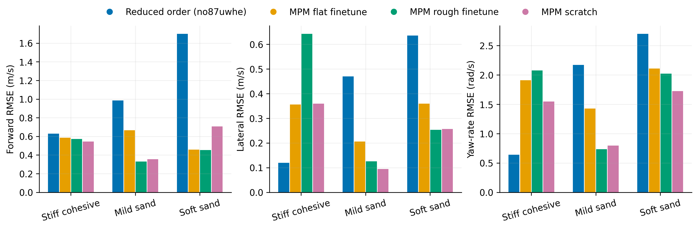
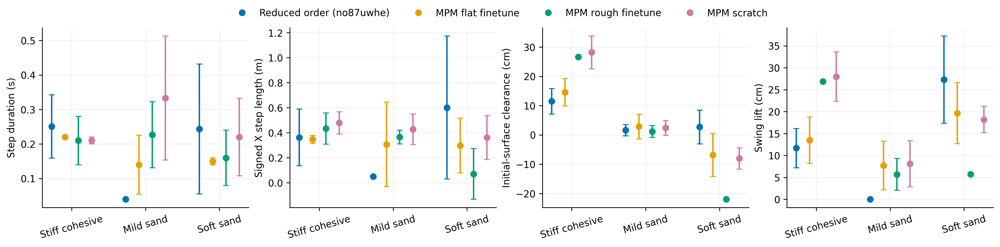
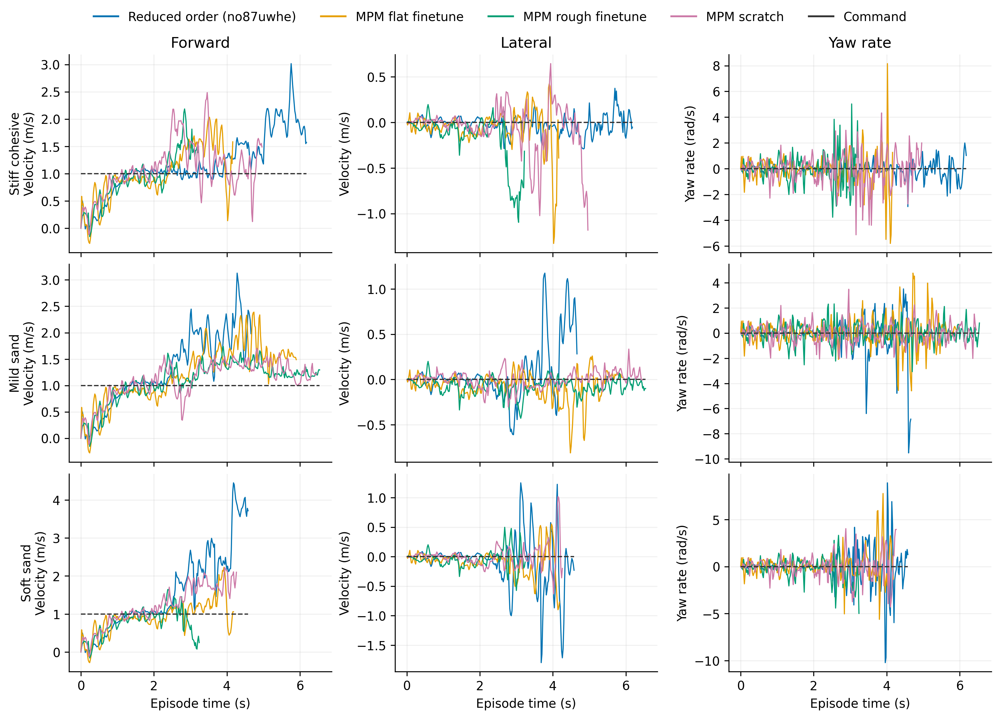

# Descending

Task: `IsaacContrib-Velocity-Sand-Descending-G1-29dof-MPM-Play`

One episode per policy/material, seed 42. Early terminations remain included.

| Material | Policy | Outcome | Duration (s) | Sand window (s) | vx RMSE (m/s) | vy RMSE (m/s) | wz RMSE (rad/s) |
|---|---|---|---:|---:|---:|---:|---:|
| Stiff cohesive | Reduced order (no87uwhe) | crossed sand bed | 6.200 | 3.680 | 0.628 | 0.120 | 0.641 |
| Stiff cohesive | MPM flat finetune | Stopped: bad_orientation | 4.180 | 1.560 | 0.585 | 0.356 | 1.910 |
| Stiff cohesive | MPM rough finetune | Stopped: outside_workspace | 3.240 | 0.760 | 0.573 | 0.643 | 2.078 |
| Stiff cohesive | MPM scratch | Stopped: bad_orientation | 4.980 | 2.660 | 0.545 | 0.359 | 1.548 |
| Mild sand | Reduced order (no87uwhe) | Stopped: bad_orientation | 4.680 | 2.260 | 0.985 | 0.470 | 2.172 |
| Mild sand | MPM flat finetune | crossed sand bed | 5.920 | 3.300 | 0.666 | 0.206 | 1.427 |
| Mild sand | MPM rough finetune | crossed sand bed | 6.560 | 4.140 | 0.331 | 0.126 | 0.735 |
| Mild sand | MPM scratch | crossed sand bed | 6.480 | 4.200 | 0.356 | 0.095 | 0.798 |
| Soft sand | Reduced order (no87uwhe) | Stopped: outside_workspace | 4.600 | 2.180 | 1.701 | 0.635 | 2.702 |
| Soft sand | MPM flat finetune | Stopped: bad_orientation | 4.200 | 1.580 | 0.457 | 0.360 | 2.108 |
| Soft sand | MPM rough finetune | Stopped: bad_orientation | 3.260 | 0.820 | 0.453 | 0.253 | 2.022 |
| Soft sand | MPM scratch | Stopped: bad_orientation | 4.280 | 2.080 | 0.707 | 0.257 | 1.726 |

[Tracking PDF](tracking.pdf)

| Material | Policy | Steps / swings | Step duration (s) | Signed X step length (m) | Clearance (cm) | Swing lift (cm) |
|---|---|---:|---:|---:|---:|---:|
| Stiff cohesive | Reduced order (no87uwhe) | 13 / 13 | 0.251 ± 0.092 | 0.363 ± 0.227 | 11.466 ± 4.321 | 11.662 ± 4.497 |
| Stiff cohesive | MPM flat finetune | 3 / 3 | 0.220 ± 0.000 | 0.347 ± 0.033 | 14.580 ± 4.700 | 13.486 ± 5.289 |
| Stiff cohesive | MPM rough finetune | 2 / 1 | 0.210 ± 0.070 | 0.434 ± 0.125 | 26.631 ± 0.000 | 26.861 ± 0.000 |
| Stiff cohesive | MPM scratch | 2 / 5 | 0.210 ± 0.010 | 0.479 ± 0.089 | 28.186 ± 5.590 | 27.994 ± 5.625 |
| Mild sand | Reduced order (no87uwhe) | 1 / 2 | 0.040 ± 0.000 | 0.050 ± 0.000 | 1.597 ± 1.892 | 0.000 ± 0.000 |
| Mild sand | MPM flat finetune | 6 / 10 | 0.140 ± 0.086 | 0.307 ± 0.337 | 2.847 ± 4.194 | 7.716 ± 5.549 |
| Mild sand | MPM rough finetune | 6 / 9 | 0.227 ± 0.096 | 0.366 ± 0.055 | 1.134 ± 2.031 | 5.672 ± 3.628 |
| Mild sand | MPM scratch | 12 / 11 | 0.333 ± 0.180 | 0.428 ± 0.122 | 2.380 ± 2.573 | 8.099 ± 5.246 |
| Soft sand | Reduced order (no87uwhe) | 6 / 6 | 0.243 ± 0.188 | 0.601 ± 0.572 | 2.706 ± 5.760 | 27.286 ± 9.961 |
| Soft sand | MPM flat finetune | 2 / 3 | 0.150 ± 0.010 | 0.298 ± 0.218 | -6.823 ± 7.379 | 19.629 ± 6.955 |
| Soft sand | MPM rough finetune | 2 / 1 | 0.160 ± 0.080 | 0.071 ± 0.202 | -21.969 ± 0.000 | 5.687 ± 0.000 |
| Soft sand | MPM scratch | 5 / 4 | 0.220 ± 0.112 | 0.362 ± 0.175 | -8.041 ± 3.658 | 18.182 ± 3.014 |

[Gait PDF](gait.pdf)

[Traces PDF](traces.pdf)

Gait bars show variation between events in one rollout, not uncertainty across seeds. Clearance uses the initial surface, not the deformed particle surface. Signed X steps can be negative during backward motion and do not measure lateral step length. Missing points mean no complete eligible event.

## Videos

- [basalt_like: 2×2 comparison](../../../videos/four_policy_20261022_v2/descending/comparison_basalt_like.mp4)
  - [Reduced order (no87uwhe)](../../../videos/four_policy_20261022_v2/descending/basalt_like__soft_contact__seed42/rollout.mp4) · [raw data](basalt_like__soft_contact__seed42/trace.npz) · [events](basalt_like__soft_contact__seed42/gait_events.json)
  - [MPM flat finetune](../../../videos/four_policy_20261022_v2/descending/basalt_like__mpm_flat__seed42/rollout.mp4) · [raw data](basalt_like__mpm_flat__seed42/trace.npz) · [events](basalt_like__mpm_flat__seed42/gait_events.json)
  - [MPM rough finetune](../../../videos/four_policy_20261022_v2/descending/basalt_like__mpm_rough__seed42/rollout.mp4) · [raw data](basalt_like__mpm_rough__seed42/trace.npz) · [events](basalt_like__mpm_rough__seed42/gait_events.json)
  - [MPM scratch](../../../videos/four_policy_20261022_v2/descending/basalt_like__scratch__seed42/rollout.mp4) · [raw data](basalt_like__scratch__seed42/trace.npz) · [events](basalt_like__scratch__seed42/gait_events.json)
- [mild_sand: 2×2 comparison](../../../videos/four_policy_20261022_v2/descending/comparison_mild_sand.mp4)
  - [Reduced order (no87uwhe)](../../../videos/four_policy_20261022_v2/descending/mild_sand__soft_contact__seed42/rollout.mp4) · [raw data](mild_sand__soft_contact__seed42/trace.npz) · [events](mild_sand__soft_contact__seed42/gait_events.json)
  - [MPM flat finetune](../../../videos/four_policy_20261022_v2/descending/mild_sand__mpm_flat__seed42/rollout.mp4) · [raw data](mild_sand__mpm_flat__seed42/trace.npz) · [events](mild_sand__mpm_flat__seed42/gait_events.json)
  - [MPM rough finetune](../../../videos/four_policy_20261022_v2/descending/mild_sand__mpm_rough__seed42/rollout.mp4) · [raw data](mild_sand__mpm_rough__seed42/trace.npz) · [events](mild_sand__mpm_rough__seed42/gait_events.json)
  - [MPM scratch](../../../videos/four_policy_20261022_v2/descending/mild_sand__scratch__seed42/rollout.mp4) · [raw data](mild_sand__scratch__seed42/trace.npz) · [events](mild_sand__scratch__seed42/gait_events.json)
- [soft_sand: 2×2 comparison](../../../videos/four_policy_20261022_v2/descending/comparison_soft_sand.mp4)
  - [Reduced order (no87uwhe)](../../../videos/four_policy_20261022_v2/descending/soft_sand__soft_contact__seed42/rollout.mp4) · [raw data](soft_sand__soft_contact__seed42/trace.npz) · [events](soft_sand__soft_contact__seed42/gait_events.json)
  - [MPM flat finetune](../../../videos/four_policy_20261022_v2/descending/soft_sand__mpm_flat__seed42/rollout.mp4) · [raw data](soft_sand__mpm_flat__seed42/trace.npz) · [events](soft_sand__mpm_flat__seed42/gait_events.json)
  - [MPM rough finetune](../../../videos/four_policy_20261022_v2/descending/soft_sand__mpm_rough__seed42/rollout.mp4) · [raw data](soft_sand__mpm_rough__seed42/trace.npz) · [events](soft_sand__mpm_rough__seed42/gait_events.json)
  - [MPM scratch](../../../videos/four_policy_20261022_v2/descending/soft_sand__scratch__seed42/rollout.mp4) · [raw data](soft_sand__scratch__seed42/trace.npz) · [events](soft_sand__scratch__seed42/gait_events.json)
