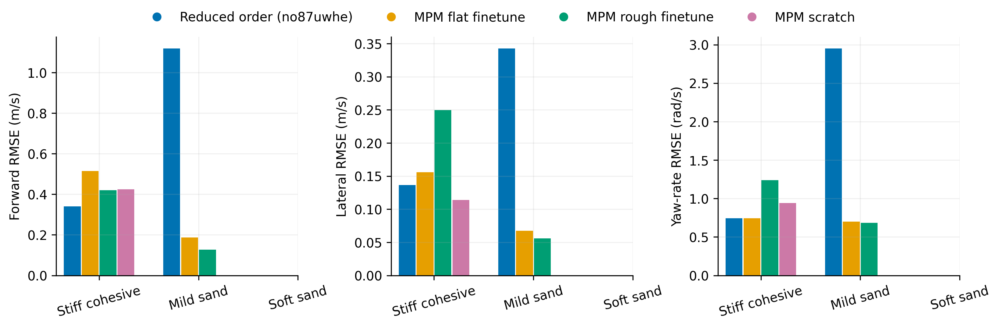
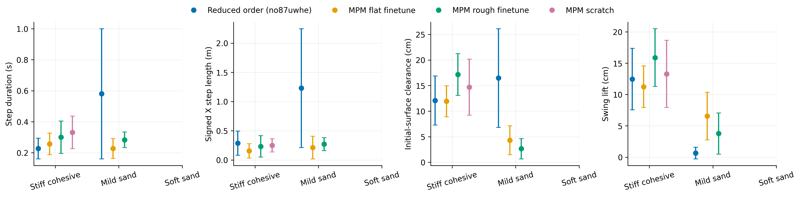
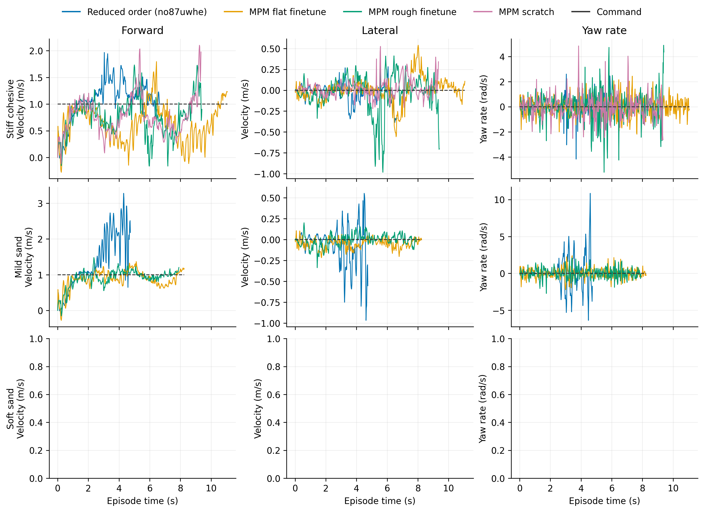

# Dune

Task: `IsaacContrib-Velocity-Sand-Dune-G1-29dof-MPM-Play`

One episode per policy/material, seed 42. Early terminations remain included.

| Material | Policy | Outcome | Duration (s) | Sand window (s) | vx RMSE (m/s) | vy RMSE (m/s) | wz RMSE (rad/s) |
|---|---|---|---:|---:|---:|---:|---:|
| Stiff cohesive | Reduced order (no87uwhe) | crossed sand bed | 6.660 | 4.120 | 0.341 | 0.137 | 0.743 |
| Stiff cohesive | MPM flat finetune | Stopped: outside_workspace | 11.080 | 8.460 | 0.515 | 0.156 | 0.744 |
| Stiff cohesive | MPM rough finetune | crossed sand bed | 9.420 | 6.940 | 0.421 | 0.250 | 1.238 |
| Stiff cohesive | MPM scratch | crossed sand bed | 9.360 | 6.980 | 0.425 | 0.114 | 0.941 |
| Mild sand | Reduced order (no87uwhe) | Stopped: bad_orientation | 4.760 | 2.280 | 1.120 | 0.343 | 2.952 |
| Mild sand | MPM flat finetune | crossed sand bed | 8.260 | 5.640 | 0.187 | 0.068 | 0.702 |
| Mild sand | MPM rough finetune | crossed sand bed | 7.920 | 5.480 | 0.127 | 0.056 | 0.682 |

[Tracking PDF](tracking.pdf)

| Material | Policy | Steps / swings | Step duration (s) | Signed X step length (m) | Clearance (cm) | Swing lift (cm) |
|---|---|---:|---:|---:|---:|---:|
| Stiff cohesive | Reduced order (no87uwhe) | 17 / 17 | 0.227 ± 0.066 | 0.287 ± 0.207 | 12.073 ± 4.786 | 12.459 ± 4.919 |
| Stiff cohesive | MPM flat finetune | 32 / 32 | 0.257 ± 0.070 | 0.156 ± 0.121 | 11.918 ± 3.035 | 11.240 ± 3.320 |
| Stiff cohesive | MPM rough finetune | 22 / 22 | 0.300 ± 0.105 | 0.232 ± 0.184 | 17.157 ± 4.084 | 15.890 ± 4.605 |
| Stiff cohesive | MPM scratch | 20 / 20 | 0.331 ± 0.105 | 0.250 ± 0.113 | 14.691 ± 5.479 | 13.285 ± 5.354 |
| Mild sand | Reduced order (no87uwhe) | 2 / 3 | 0.580 ± 0.420 | 1.231 ± 1.017 | 16.465 ± 9.643 | 0.658 ± 0.931 |
| Mild sand | MPM flat finetune | 22 / 23 | 0.227 ± 0.063 | 0.213 ± 0.195 | 4.308 ± 2.822 | 6.566 ± 3.793 |
| Mild sand | MPM rough finetune | 18 / 18 | 0.283 ± 0.050 | 0.271 ± 0.110 | 2.646 ± 1.988 | 3.778 ± 3.282 |

[Gait PDF](gait.pdf)

[Traces PDF](traces.pdf)

Gait bars show variation between events in one rollout, not uncertainty across seeds. Clearance uses the initial surface, not the deformed particle surface. Signed X steps can be negative during backward motion and do not measure lateral step length. Missing points mean no complete eligible event.

## Videos

- [basalt_like: 2×2 comparison](../../../videos/four_policy_20261022_v2/dune/comparison_basalt_like.mp4)
  - [Reduced order (no87uwhe)](../../../videos/four_policy_20261022_v2/dune/basalt_like__soft_contact__seed42/rollout.mp4) · [raw data](basalt_like__soft_contact__seed42/trace.npz) · [events](basalt_like__soft_contact__seed42/gait_events.json)
  - [MPM flat finetune](../../../videos/four_policy_20261022_v2/dune/basalt_like__mpm_flat__seed42/rollout.mp4) · [raw data](basalt_like__mpm_flat__seed42/trace.npz) · [events](basalt_like__mpm_flat__seed42/gait_events.json)
  - [MPM rough finetune](../../../videos/four_policy_20261022_v2/dune/basalt_like__mpm_rough__seed42/rollout.mp4) · [raw data](basalt_like__mpm_rough__seed42/trace.npz) · [events](basalt_like__mpm_rough__seed42/gait_events.json)
  - [MPM scratch](../../../videos/four_policy_20261022_v2/dune/basalt_like__scratch__seed42/rollout.mp4) · [raw data](basalt_like__scratch__seed42/trace.npz) · [events](basalt_like__scratch__seed42/gait_events.json)
- [mild_sand: 2×2 comparison](../../../videos/four_policy_20261022_v2/dune/comparison_mild_sand.mp4)
  - [Reduced order (no87uwhe)](../../../videos/four_policy_20261022_v2/dune/mild_sand__soft_contact__seed42/rollout.mp4) · [raw data](mild_sand__soft_contact__seed42/trace.npz) · [events](mild_sand__soft_contact__seed42/gait_events.json)
  - [MPM flat finetune](../../../videos/four_policy_20261022_v2/dune/mild_sand__mpm_flat__seed42/rollout.mp4) · [raw data](mild_sand__mpm_flat__seed42/trace.npz) · [events](mild_sand__mpm_flat__seed42/gait_events.json)
  - [MPM rough finetune](../../../videos/four_policy_20261022_v2/dune/mild_sand__mpm_rough__seed42/rollout.mp4) · [raw data](mild_sand__mpm_rough__seed42/trace.npz) · [events](mild_sand__mpm_rough__seed42/gait_events.json)
  - [MPM scratch](../../../videos/four_policy_20261022_v2/dune/mild_sand__scratch__seed42/rollout.mp4) · [raw data](mild_sand__scratch__seed42/trace.npz) · [events](mild_sand__scratch__seed42/gait_events.json)
- [soft_sand: 2×2 comparison](../../../videos/four_policy_20261022_v2/dune/comparison_soft_sand.mp4)
  - [Reduced order (no87uwhe)](../../../videos/four_policy_20261022_v2/dune/soft_sand__soft_contact__seed42/rollout.mp4) · [raw data](soft_sand__soft_contact__seed42/trace.npz) · [events](soft_sand__soft_contact__seed42/gait_events.json)
  - [MPM flat finetune](../../../videos/four_policy_20261022_v2/dune/soft_sand__mpm_flat__seed42/rollout.mp4) · [raw data](soft_sand__mpm_flat__seed42/trace.npz) · [events](soft_sand__mpm_flat__seed42/gait_events.json)
  - [MPM rough finetune](../../../videos/four_policy_20261022_v2/dune/soft_sand__mpm_rough__seed42/rollout.mp4) · [raw data](soft_sand__mpm_rough__seed42/trace.npz) · [events](soft_sand__mpm_rough__seed42/gait_events.json)
  - [MPM scratch](../../../videos/four_policy_20261022_v2/dune/soft_sand__scratch__seed42/rollout.mp4) · [raw data](soft_sand__scratch__seed42/trace.npz) · [events](soft_sand__scratch__seed42/gait_events.json)
