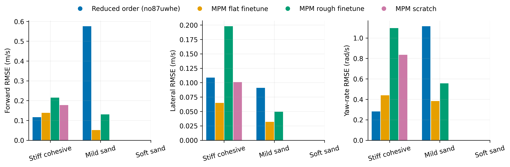
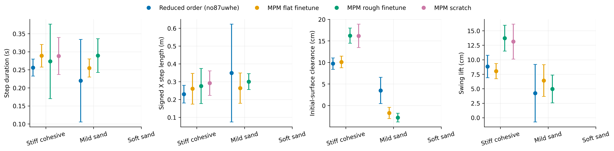
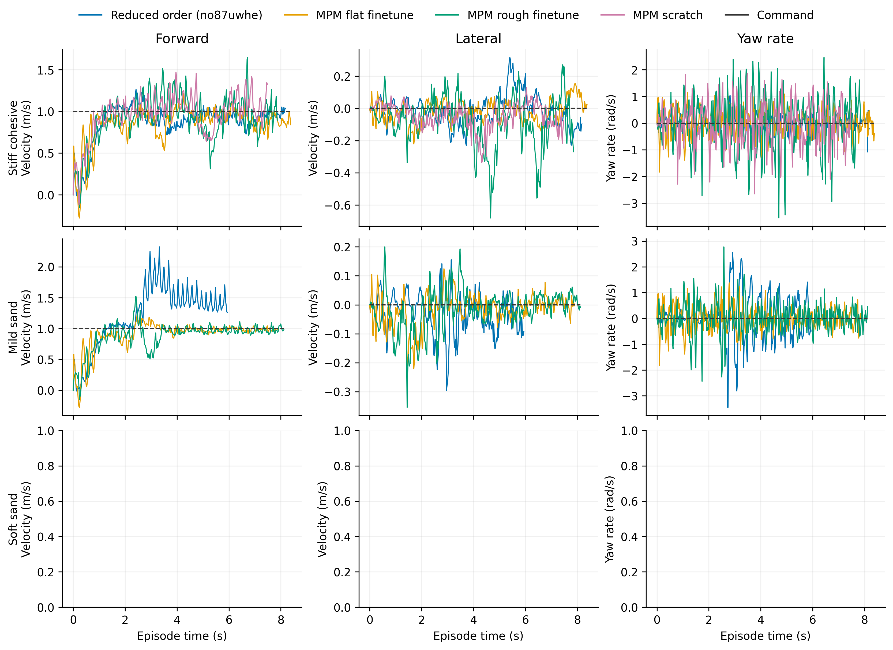

# Flat

Task: `IsaacContrib-Velocity-Sand-Flat-G1-29dof-MPM-Play`

One episode per policy/material, seed 42. Early terminations remain included.

| Material | Policy | Outcome | Duration (s) | Sand window (s) | vx RMSE (m/s) | vy RMSE (m/s) | wz RMSE (rad/s) |
|---|---|---|---:|---:|---:|---:|---:|
| Stiff cohesive | Reduced order (no87uwhe) | crossed sand bed | 8.200 | 5.640 | 0.117 | 0.109 | 0.282 |
| Stiff cohesive | MPM flat finetune | crossed sand bed | 8.400 | 5.780 | 0.138 | 0.065 | 0.440 |
| Stiff cohesive | MPM rough finetune | crossed sand bed | 7.880 | 5.380 | 0.215 | 0.198 | 1.097 |
| Stiff cohesive | MPM scratch | crossed sand bed | 7.500 | 5.160 | 0.178 | 0.101 | 0.835 |
| Mild sand | Reduced order (no87uwhe) | crossed sand bed | 5.960 | 3.540 | 0.575 | 0.091 | 1.114 |
| Mild sand | MPM flat finetune | crossed sand bed | 7.920 | 5.300 | 0.051 | 0.032 | 0.384 |
| Mild sand | MPM rough finetune | crossed sand bed | 8.140 | 5.680 | 0.131 | 0.049 | 0.556 |

[Tracking PDF](tracking.pdf)

| Material | Policy | Steps / swings | Step duration (s) | Signed X step length (m) | Clearance (cm) | Swing lift (cm) |
|---|---|---:|---:|---:|---:|---:|
| Stiff cohesive | Reduced order (no87uwhe) | 21 / 21 | 0.256 ± 0.024 | 0.230 ± 0.050 | 9.726 ± 1.321 | 8.838 ± 1.937 |
| Stiff cohesive | MPM flat finetune | 18 / 18 | 0.289 ± 0.031 | 0.261 ± 0.086 | 10.105 ± 1.346 | 8.029 ± 1.310 |
| Stiff cohesive | MPM rough finetune | 18 / 18 | 0.273 ± 0.103 | 0.276 ± 0.098 | 16.217 ± 1.747 | 13.719 ± 2.224 |
| Stiff cohesive | MPM scratch | 17 / 16 | 0.288 ± 0.051 | 0.292 ± 0.069 | 16.162 ± 2.719 | 13.130 ± 3.007 |
| Mild sand | Reduced order (no87uwhe) | 9 / 13 | 0.220 ± 0.114 | 0.349 ± 0.274 | 3.501 ± 3.033 | 4.232 ± 4.957 |
| Mild sand | MPM flat finetune | 20 / 20 | 0.255 ± 0.025 | 0.264 ± 0.085 | -1.724 ± 1.310 | 6.406 ± 2.732 |
| Mild sand | MPM rough finetune | 17 / 17 | 0.289 ± 0.047 | 0.301 ± 0.044 | -2.798 ± 1.003 | 4.956 ± 2.391 |

[Gait PDF](gait.pdf)

[Traces PDF](traces.pdf)

Gait bars show variation between events in one rollout, not uncertainty across seeds. Clearance uses the initial surface, not the deformed particle surface. Signed X steps can be negative during backward motion and do not measure lateral step length. Missing points mean no complete eligible event.

## Videos

- [basalt_like: 2×2 comparison](../../../videos/four_policy_20261022_v2/flat/comparison_basalt_like.mp4)
  - [Reduced order (no87uwhe)](../../../videos/four_policy_20261022_v2/flat/basalt_like__soft_contact__seed42/rollout.mp4) · [raw data](basalt_like__soft_contact__seed42/trace.npz) · [events](basalt_like__soft_contact__seed42/gait_events.json)
  - [MPM flat finetune](../../../videos/four_policy_20261022_v2/flat/basalt_like__mpm_flat__seed42/rollout.mp4) · [raw data](basalt_like__mpm_flat__seed42/trace.npz) · [events](basalt_like__mpm_flat__seed42/gait_events.json)
  - [MPM rough finetune](../../../videos/four_policy_20261022_v2/flat/basalt_like__mpm_rough__seed42/rollout.mp4) · [raw data](basalt_like__mpm_rough__seed42/trace.npz) · [events](basalt_like__mpm_rough__seed42/gait_events.json)
  - [MPM scratch](../../../videos/four_policy_20261022_v2/flat/basalt_like__scratch__seed42/rollout.mp4) · [raw data](basalt_like__scratch__seed42/trace.npz) · [events](basalt_like__scratch__seed42/gait_events.json)
- [mild_sand: 2×2 comparison](../../../videos/four_policy_20261022_v2/flat/comparison_mild_sand.mp4)
  - [Reduced order (no87uwhe)](../../../videos/four_policy_20261022_v2/flat/mild_sand__soft_contact__seed42/rollout.mp4) · [raw data](mild_sand__soft_contact__seed42/trace.npz) · [events](mild_sand__soft_contact__seed42/gait_events.json)
  - [MPM flat finetune](../../../videos/four_policy_20261022_v2/flat/mild_sand__mpm_flat__seed42/rollout.mp4) · [raw data](mild_sand__mpm_flat__seed42/trace.npz) · [events](mild_sand__mpm_flat__seed42/gait_events.json)
  - [MPM rough finetune](../../../videos/four_policy_20261022_v2/flat/mild_sand__mpm_rough__seed42/rollout.mp4) · [raw data](mild_sand__mpm_rough__seed42/trace.npz) · [events](mild_sand__mpm_rough__seed42/gait_events.json)
  - [MPM scratch](../../../videos/four_policy_20261022_v2/flat/mild_sand__scratch__seed42/rollout.mp4) · [raw data](mild_sand__scratch__seed42/trace.npz) · [events](mild_sand__scratch__seed42/gait_events.json)
- [soft_sand: 2×2 comparison](../../../videos/four_policy_20261022_v2/flat/comparison_soft_sand.mp4)
  - [Reduced order (no87uwhe)](../../../videos/four_policy_20261022_v2/flat/soft_sand__soft_contact__seed42/rollout.mp4) · [raw data](soft_sand__soft_contact__seed42/trace.npz) · [events](soft_sand__soft_contact__seed42/gait_events.json)
  - [MPM flat finetune](../../../videos/four_policy_20261022_v2/flat/soft_sand__mpm_flat__seed42/rollout.mp4) · [raw data](soft_sand__mpm_flat__seed42/trace.npz) · [events](soft_sand__mpm_flat__seed42/gait_events.json)
  - [MPM rough finetune](../../../videos/four_policy_20261022_v2/flat/soft_sand__mpm_rough__seed42/rollout.mp4) · [raw data](soft_sand__mpm_rough__seed42/trace.npz) · [events](soft_sand__mpm_rough__seed42/gait_events.json)
  - [MPM scratch](../../../videos/four_policy_20261022_v2/flat/soft_sand__scratch__seed42/rollout.mp4) · [raw data](soft_sand__scratch__seed42/trace.npz) · [events](soft_sand__scratch__seed42/gait_events.json)
