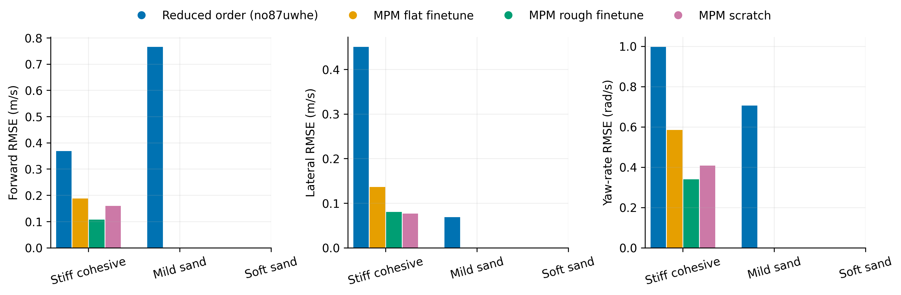
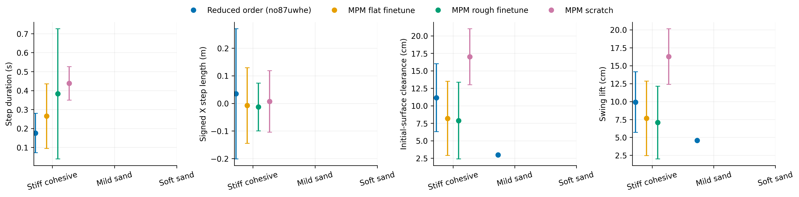
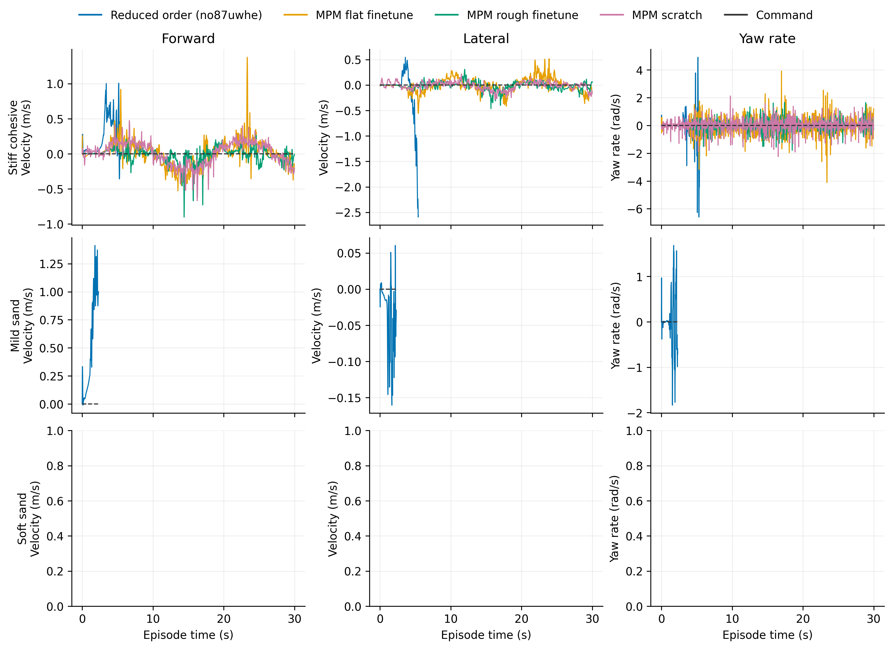

# Standing Tilt

Task: `IsaacContrib-Balance-Sand-Tilting-G1-29dof-MPM-Play`

One episode per policy/material, seed 42. Early terminations remain included.

| Material | Policy | Outcome | Duration (s) | Sand window (s) | vx RMSE (m/s) | vy RMSE (m/s) | wz RMSE (rad/s) |
|---|---|---|---:|---:|---:|---:|---:|
| Stiff cohesive | Reduced order (no87uwhe) | Stopped: bad_orientation | 5.440 | 4.820 | 0.369 | 0.450 | 0.997 |
| Stiff cohesive | MPM flat finetune | time limit | 30.000 | 29.500 | 0.188 | 0.136 | 0.584 |
| Stiff cohesive | MPM rough finetune | time limit | 30.000 | 29.500 | 0.107 | 0.080 | 0.340 |
| Stiff cohesive | MPM scratch | time limit | 30.000 | 29.500 | 0.159 | 0.077 | 0.408 |
| Mild sand | Reduced order (no87uwhe) | Stopped: outside_workspace | 2.320 | 1.820 | 0.765 | 0.069 | 0.705 |

[Tracking PDF](tracking.pdf)

| Material | Policy | Steps / swings | Step duration (s) | Signed X step length (m) | Clearance (cm) | Swing lift (cm) |
|---|---|---:|---:|---:|---:|---:|
| Stiff cohesive | Reduced order (no87uwhe) | 5 / 8 | 0.176 ± 0.104 | 0.035 ± 0.236 | 11.153 ± 4.856 | 9.920 ± 4.225 |
| Stiff cohesive | MPM flat finetune | 85 / 92 | 0.265 ± 0.171 | -0.008 ± 0.137 | 8.188 ± 5.298 | 7.659 ± 5.189 |
| Stiff cohesive | MPM rough finetune | 51 / 58 | 0.383 ± 0.343 | -0.013 ± 0.086 | 7.880 ± 5.484 | 7.071 ± 5.071 |
| Stiff cohesive | MPM scratch | 66 / 67 | 0.438 ± 0.089 | 0.007 ± 0.111 | 17.008 ± 4.007 | 16.273 ± 3.876 |
| Mild sand | Reduced order (no87uwhe) | 0 / 1 | — | — | 2.967 ± 0.000 | 4.573 ± 0.000 |

[Gait PDF](gait.pdf)

[Traces PDF](traces.pdf)

Gait bars show variation between events in one rollout, not uncertainty across seeds. Clearance uses the initial surface, not the deformed particle surface. Signed X steps can be negative during backward motion and do not measure lateral step length. Missing points mean no complete eligible event.

## Videos

- [basalt_like: 2×2 comparison](../../../videos/four_policy_20261022_v2/standing_tilt/comparison_basalt_like.mp4)
  - [Reduced order (no87uwhe)](../../../videos/four_policy_20261022_v2/standing_tilt/basalt_like__soft_contact__seed42/rollout.mp4) · [raw data](basalt_like__soft_contact__seed42/trace.npz) · [events](basalt_like__soft_contact__seed42/gait_events.json)
  - [MPM flat finetune](../../../videos/four_policy_20261022_v2/standing_tilt/basalt_like__mpm_flat__seed42/rollout.mp4) · [raw data](basalt_like__mpm_flat__seed42/trace.npz) · [events](basalt_like__mpm_flat__seed42/gait_events.json)
  - [MPM rough finetune](../../../videos/four_policy_20261022_v2/standing_tilt/basalt_like__mpm_rough__seed42/rollout.mp4) · [raw data](basalt_like__mpm_rough__seed42/trace.npz) · [events](basalt_like__mpm_rough__seed42/gait_events.json)
  - [MPM scratch](../../../videos/four_policy_20261022_v2/standing_tilt/basalt_like__scratch__seed42/rollout.mp4) · [raw data](basalt_like__scratch__seed42/trace.npz) · [events](basalt_like__scratch__seed42/gait_events.json)
- [mild_sand: 2×2 comparison](../../../videos/four_policy_20261022_v2/standing_tilt/comparison_mild_sand.mp4)
  - [Reduced order (no87uwhe)](../../../videos/four_policy_20261022_v2/standing_tilt/mild_sand__soft_contact__seed42/rollout.mp4) · [raw data](mild_sand__soft_contact__seed42/trace.npz) · [events](mild_sand__soft_contact__seed42/gait_events.json)
  - [MPM flat finetune](../../../videos/four_policy_20261022_v2/standing_tilt/mild_sand__mpm_flat__seed42/rollout.mp4) · [raw data](mild_sand__mpm_flat__seed42/trace.npz) · [events](mild_sand__mpm_flat__seed42/gait_events.json)
  - [MPM rough finetune](../../../videos/four_policy_20261022_v2/standing_tilt/mild_sand__mpm_rough__seed42/rollout.mp4) · [raw data](mild_sand__mpm_rough__seed42/trace.npz) · [events](mild_sand__mpm_rough__seed42/gait_events.json)
  - [MPM scratch](../../../videos/four_policy_20261022_v2/standing_tilt/mild_sand__scratch__seed42/rollout.mp4) · [raw data](mild_sand__scratch__seed42/trace.npz) · [events](mild_sand__scratch__seed42/gait_events.json)
- [soft_sand: 2×2 comparison](../../../videos/four_policy_20261022_v2/standing_tilt/comparison_soft_sand.mp4)
  - [Reduced order (no87uwhe)](../../../videos/four_policy_20261022_v2/standing_tilt/soft_sand__soft_contact__seed42/rollout.mp4) · [raw data](soft_sand__soft_contact__seed42/trace.npz) · [events](soft_sand__soft_contact__seed42/gait_events.json)
  - [MPM flat finetune](../../../videos/four_policy_20261022_v2/standing_tilt/soft_sand__mpm_flat__seed42/rollout.mp4) · [raw data](soft_sand__mpm_flat__seed42/trace.npz) · [events](soft_sand__mpm_flat__seed42/gait_events.json)
  - [MPM rough finetune](../../../videos/four_policy_20261022_v2/standing_tilt/soft_sand__mpm_rough__seed42/rollout.mp4) · [raw data](soft_sand__mpm_rough__seed42/trace.npz) · [events](soft_sand__mpm_rough__seed42/gait_events.json)
  - [MPM scratch](../../../videos/four_policy_20261022_v2/standing_tilt/soft_sand__scratch__seed42/rollout.mp4) · [raw data](soft_sand__scratch__seed42/trace.npz) · [events](soft_sand__scratch__seed42/gait_events.json)
