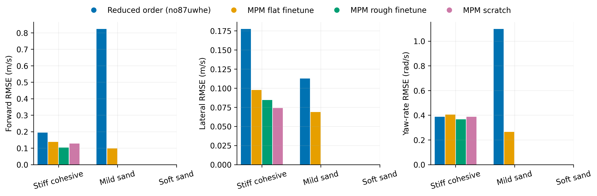
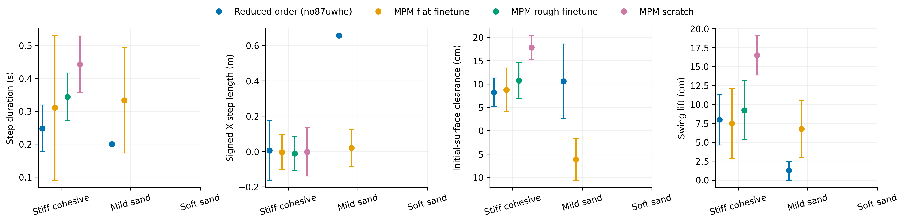
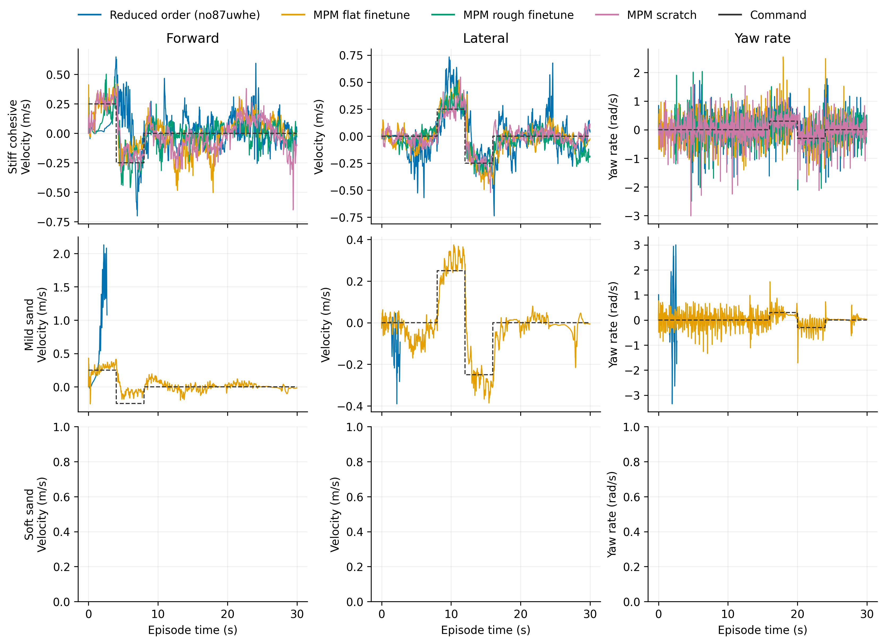

# Walking Tilt

Task: `IsaacContrib-Velocity-Sand-Tilting-G1-29dof-MPM-Play`

One episode per policy/material, seed 42. Early terminations remain included.

| Material | Policy | Outcome | Duration (s) | Sand window (s) | vx RMSE (m/s) | vy RMSE (m/s) | wz RMSE (rad/s) |
|---|---|---|---:|---:|---:|---:|---:|
| Stiff cohesive | Reduced order (no87uwhe) | time limit | 30.000 | 29.500 | 0.194 | 0.178 | 0.388 |
| Stiff cohesive | MPM flat finetune | time limit | 30.000 | 29.500 | 0.138 | 0.098 | 0.405 |
| Stiff cohesive | MPM rough finetune | time limit | 30.000 | 29.500 | 0.104 | 0.085 | 0.366 |
| Stiff cohesive | MPM scratch | time limit | 30.000 | 29.500 | 0.128 | 0.074 | 0.388 |
| Mild sand | Reduced order (no87uwhe) | Stopped: outside_workspace | 2.680 | 2.100 | 0.824 | 0.113 | 1.099 |
| Mild sand | MPM flat finetune | time limit | 30.000 | 29.500 | 0.098 | 0.069 | 0.265 |

[Tracking PDF](tracking.pdf)

| Material | Policy | Steps / swings | Step duration (s) | Signed X step length (m) | Clearance (cm) | Swing lift (cm) |
|---|---|---:|---:|---:|---:|---:|
| Stiff cohesive | Reduced order (no87uwhe) | 101 / 105 | 0.248 ± 0.071 | 0.006 ± 0.168 | 8.225 ± 3.071 | 7.968 ± 3.363 |
| Stiff cohesive | MPM flat finetune | 82 / 85 | 0.311 ± 0.220 | -0.004 ± 0.099 | 8.756 ± 4.650 | 7.450 ± 4.632 |
| Stiff cohesive | MPM rough finetune | 67 / 70 | 0.344 ± 0.073 | -0.012 ± 0.096 | 10.717 ± 3.937 | 9.226 ± 3.882 |
| Stiff cohesive | MPM scratch | 65 / 66 | 0.442 ± 0.086 | -0.002 ± 0.137 | 17.805 ± 2.587 | 16.487 ± 2.616 |
| Mild sand | Reduced order (no87uwhe) | 1 / 2 | 0.200 ± 0.000 | 0.657 ± 0.000 | 10.571 ± 7.993 | 1.243 ± 1.243 |
| Mild sand | MPM flat finetune | 48 / 51 | 0.333 ± 0.160 | 0.020 ± 0.104 | -6.151 ± 4.428 | 6.747 ± 3.800 |

[Gait PDF](gait.pdf)

[Traces PDF](traces.pdf)

Gait bars show variation between events in one rollout, not uncertainty across seeds. Clearance uses the initial surface, not the deformed particle surface. Signed X steps can be negative during backward motion and do not measure lateral step length. Missing points mean no complete eligible event.

## Videos

- [basalt_like: 2×2 comparison](../../../videos/four_policy_20261022_v2/walking_tilt/comparison_basalt_like.mp4)
  - [Reduced order (no87uwhe)](../../../videos/four_policy_20261022_v2/walking_tilt/basalt_like__soft_contact__seed42/rollout.mp4) · [raw data](basalt_like__soft_contact__seed42/trace.npz) · [events](basalt_like__soft_contact__seed42/gait_events.json)
  - [MPM flat finetune](../../../videos/four_policy_20261022_v2/walking_tilt/basalt_like__mpm_flat__seed42/rollout.mp4) · [raw data](basalt_like__mpm_flat__seed42/trace.npz) · [events](basalt_like__mpm_flat__seed42/gait_events.json)
  - [MPM rough finetune](../../../videos/four_policy_20261022_v2/walking_tilt/basalt_like__mpm_rough__seed42/rollout.mp4) · [raw data](basalt_like__mpm_rough__seed42/trace.npz) · [events](basalt_like__mpm_rough__seed42/gait_events.json)
  - [MPM scratch](../../../videos/four_policy_20261022_v2/walking_tilt/basalt_like__scratch__seed42/rollout.mp4) · [raw data](basalt_like__scratch__seed42/trace.npz) · [events](basalt_like__scratch__seed42/gait_events.json)
- [mild_sand: 2×2 comparison](../../../videos/four_policy_20261022_v2/walking_tilt/comparison_mild_sand.mp4)
  - [Reduced order (no87uwhe)](../../../videos/four_policy_20261022_v2/walking_tilt/mild_sand__soft_contact__seed42/rollout.mp4) · [raw data](mild_sand__soft_contact__seed42/trace.npz) · [events](mild_sand__soft_contact__seed42/gait_events.json)
  - [MPM flat finetune](../../../videos/four_policy_20261022_v2/walking_tilt/mild_sand__mpm_flat__seed42/rollout.mp4) · [raw data](mild_sand__mpm_flat__seed42/trace.npz) · [events](mild_sand__mpm_flat__seed42/gait_events.json)
  - [MPM rough finetune](../../../videos/four_policy_20261022_v2/walking_tilt/mild_sand__mpm_rough__seed42/rollout.mp4) · [raw data](mild_sand__mpm_rough__seed42/trace.npz) · [events](mild_sand__mpm_rough__seed42/gait_events.json)
  - [MPM scratch](../../../videos/four_policy_20261022_v2/walking_tilt/mild_sand__scratch__seed42/rollout.mp4) · [raw data](mild_sand__scratch__seed42/trace.npz) · [events](mild_sand__scratch__seed42/gait_events.json)
- [soft_sand: 2×2 comparison](../../../videos/four_policy_20261022_v2/walking_tilt/comparison_soft_sand.mp4)
  - [Reduced order (no87uwhe)](../../../videos/four_policy_20261022_v2/walking_tilt/soft_sand__soft_contact__seed42/rollout.mp4) · [raw data](soft_sand__soft_contact__seed42/trace.npz) · [events](soft_sand__soft_contact__seed42/gait_events.json)
  - [MPM flat finetune](../../../videos/four_policy_20261022_v2/walking_tilt/soft_sand__mpm_flat__seed42/rollout.mp4) · [raw data](soft_sand__mpm_flat__seed42/trace.npz) · [events](soft_sand__mpm_flat__seed42/gait_events.json)
  - [MPM rough finetune](../../../videos/four_policy_20261022_v2/walking_tilt/soft_sand__mpm_rough__seed42/rollout.mp4) · [raw data](soft_sand__mpm_rough__seed42/trace.npz) · [events](soft_sand__mpm_rough__seed42/gait_events.json)
  - [MPM scratch](../../../videos/four_policy_20261022_v2/walking_tilt/soft_sand__scratch__seed42/rollout.mp4) · [raw data](soft_sand__scratch__seed42/trace.npz) · [events](soft_sand__scratch__seed42/gait_events.json)
