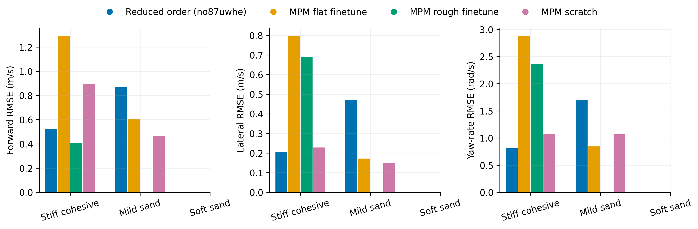
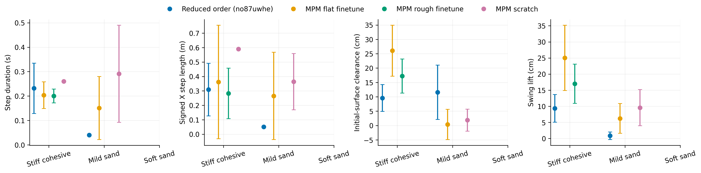
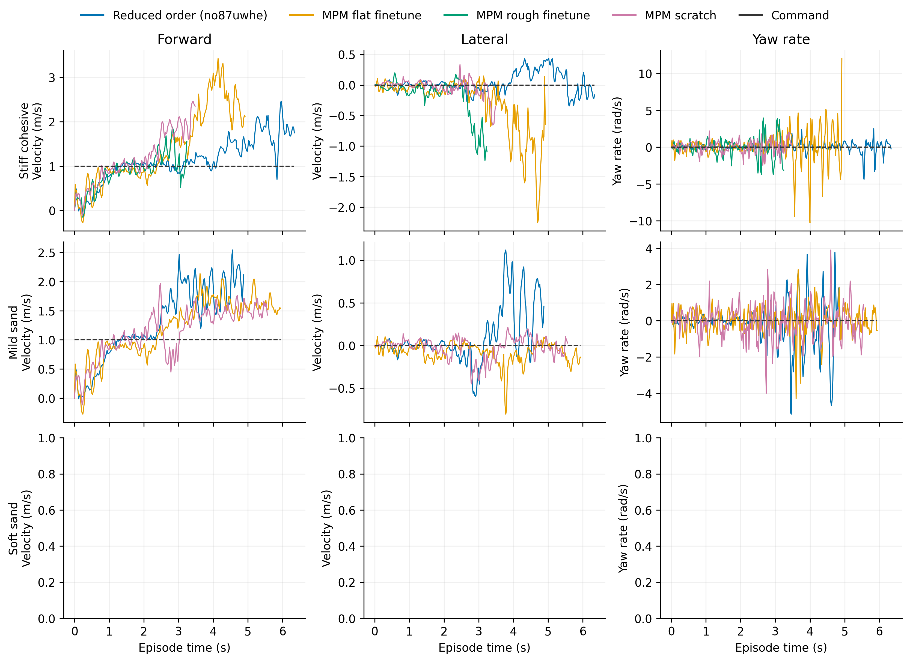

# Descending

Task: `IsaacContrib-Velocity-Sand-Descending-G1-29dof-MPM-Play`

One episode per policy/material, seed 42. Early terminations remain included.

| Material | Policy | Outcome | Duration (s) | Sand window (s) | vx RMSE (m/s) | vy RMSE (m/s) | wz RMSE (rad/s) |
|---|---|---|---:|---:|---:|---:|---:|
| Stiff cohesive | Reduced order (no87uwhe) | crossed sand bed | 6.360 | 3.740 | 0.523 | 0.204 | 0.808 |
| Stiff cohesive | MPM flat finetune | Stopped: bad_orientation | 4.940 | 2.300 | 1.293 | 0.797 | 2.880 |
| Stiff cohesive | MPM rough finetune | Stopped: outside_workspace | 3.260 | 0.740 | 0.408 | 0.690 | 2.366 |
| Stiff cohesive | MPM scratch | Stopped: bad_orientation | 3.500 | 1.200 | 0.895 | 0.228 | 1.080 |
| Mild sand | Reduced order (no87uwhe) | Stopped: outside_workspace | 4.900 | 2.480 | 0.867 | 0.472 | 1.697 |
| Mild sand | MPM flat finetune | crossed sand bed | 5.960 | 3.360 | 0.607 | 0.172 | 0.846 |
| Mild sand | MPM scratch | Stopped: outside_workspace | 5.580 | 3.280 | 0.464 | 0.150 | 1.068 |

[Tracking PDF](tracking.pdf)

| Material | Policy | Steps / swings | Step duration (s) | Signed X step length (m) | Clearance (cm) | Swing lift (cm) |
|---|---|---:|---:|---:|---:|---:|
| Stiff cohesive | Reduced order (no87uwhe) | 12 / 12 | 0.232 ± 0.103 | 0.309 ± 0.182 | 9.582 ± 4.682 | 9.338 ± 4.309 |
| Stiff cohesive | MPM flat finetune | 6 / 7 | 0.203 ± 0.055 | 0.362 ± 0.393 | 26.054 ± 8.870 | 25.028 ± 10.151 |
| Stiff cohesive | MPM rough finetune | 3 / 2 | 0.200 ± 0.028 | 0.283 ± 0.175 | 17.219 ± 5.934 | 16.971 ± 6.095 |
| Stiff cohesive | MPM scratch | 1 / 0 | 0.260 ± 0.000 | 0.590 ± 0.000 | — | — |
| Mild sand | Reduced order (no87uwhe) | 1 / 3 | 0.040 ± 0.000 | 0.051 ± 0.000 | 11.551 ± 9.456 | 0.835 ± 1.181 |
| Mild sand | MPM flat finetune | 11 / 13 | 0.151 ± 0.129 | 0.265 ± 0.302 | 0.364 ± 5.253 | 6.222 ± 4.623 |
| Mild sand | MPM scratch | 9 / 9 | 0.291 ± 0.199 | 0.364 ± 0.195 | 1.872 ± 3.831 | 9.571 ± 5.612 |

[Gait PDF](gait.pdf)

[Traces PDF](traces.pdf)

Gait bars show variation between events in one rollout, not uncertainty across seeds. Clearance uses the initial surface, not the deformed particle surface. Signed X steps can be negative during backward motion and do not measure lateral step length. Missing points mean no complete eligible event.

## Videos

- [basalt_like: 2×2 comparison](../../../videos/four_policy_20261022_v3/descending/comparison_basalt_like.mp4)
  - [Reduced order (no87uwhe)](../../../videos/four_policy_20261022_v3/descending/basalt_like__soft_contact__seed42/rollout.mp4) · [raw data](basalt_like__soft_contact__seed42/trace.npz) · [events](basalt_like__soft_contact__seed42/gait_events.json)
  - [MPM flat finetune](../../../videos/four_policy_20261022_v3/descending/basalt_like__mpm_flat__seed42/rollout.mp4) · [raw data](basalt_like__mpm_flat__seed42/trace.npz) · [events](basalt_like__mpm_flat__seed42/gait_events.json)
  - [MPM rough finetune](../../../videos/four_policy_20261022_v3/descending/basalt_like__mpm_rough__seed42/rollout.mp4) · [raw data](basalt_like__mpm_rough__seed42/trace.npz) · [events](basalt_like__mpm_rough__seed42/gait_events.json)
  - [MPM scratch](../../../videos/four_policy_20261022_v3/descending/basalt_like__scratch__seed42/rollout.mp4) · [raw data](basalt_like__scratch__seed42/trace.npz) · [events](basalt_like__scratch__seed42/gait_events.json)
- [mild_sand: 2×2 comparison](../../../videos/four_policy_20261022_v3/descending/comparison_mild_sand.mp4)
  - [Reduced order (no87uwhe)](../../../videos/four_policy_20261022_v3/descending/mild_sand__soft_contact__seed42/rollout.mp4) · [raw data](mild_sand__soft_contact__seed42/trace.npz) · [events](mild_sand__soft_contact__seed42/gait_events.json)
  - [MPM flat finetune](../../../videos/four_policy_20261022_v3/descending/mild_sand__mpm_flat__seed42/rollout.mp4) · [raw data](mild_sand__mpm_flat__seed42/trace.npz) · [events](mild_sand__mpm_flat__seed42/gait_events.json)
  - [MPM rough finetune](../../../videos/four_policy_20261022_v3/descending/mild_sand__mpm_rough__seed42/rollout.mp4) · [raw data](mild_sand__mpm_rough__seed42/trace.npz) · [events](mild_sand__mpm_rough__seed42/gait_events.json)
  - [MPM scratch](../../../videos/four_policy_20261022_v3/descending/mild_sand__scratch__seed42/rollout.mp4) · [raw data](mild_sand__scratch__seed42/trace.npz) · [events](mild_sand__scratch__seed42/gait_events.json)
- [soft_sand: 2×2 comparison](../../../videos/four_policy_20261022_v3/descending/comparison_soft_sand.mp4)
  - [Reduced order (no87uwhe)](../../../videos/four_policy_20261022_v3/descending/soft_sand__soft_contact__seed42/rollout.mp4) · [raw data](soft_sand__soft_contact__seed42/trace.npz) · [events](soft_sand__soft_contact__seed42/gait_events.json)
  - [MPM flat finetune](../../../videos/four_policy_20261022_v3/descending/soft_sand__mpm_flat__seed42/rollout.mp4) · [raw data](soft_sand__mpm_flat__seed42/trace.npz) · [events](soft_sand__mpm_flat__seed42/gait_events.json)
  - [MPM rough finetune](../../../videos/four_policy_20261022_v3/descending/soft_sand__mpm_rough__seed42/rollout.mp4) · [raw data](soft_sand__mpm_rough__seed42/trace.npz) · [events](soft_sand__mpm_rough__seed42/gait_events.json)
  - [MPM scratch](../../../videos/four_policy_20261022_v3/descending/soft_sand__scratch__seed42/rollout.mp4) · [raw data](soft_sand__scratch__seed42/trace.npz) · [events](soft_sand__scratch__seed42/gait_events.json)
