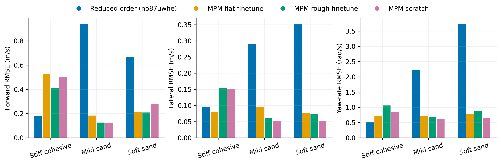
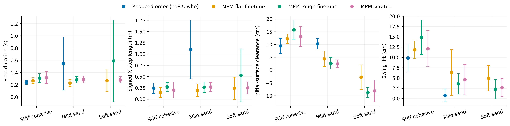
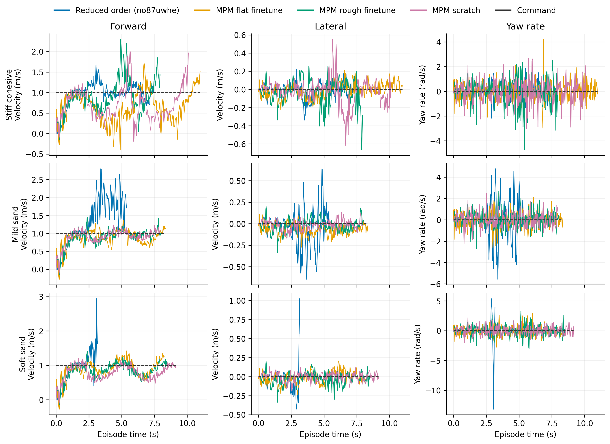

# Dune

Task: `IsaacContrib-Velocity-Sand-Dune-G1-29dof-MPM-Play`

One episode per policy/material, seed 42. Early terminations remain included.

| Material | Policy | Outcome | Duration (s) | Sand window (s) | vx RMSE (m/s) | vy RMSE (m/s) | wz RMSE (rad/s) |
|---|---|---|---:|---:|---:|---:|---:|
| Stiff cohesive | Reduced order (no87uwhe) | crossed sand bed | 7.480 | 4.940 | 0.182 | 0.096 | 0.503 |
| Stiff cohesive | MPM flat finetune | crossed sand bed | 11.000 | 8.380 | 0.525 | 0.081 | 0.711 |
| Stiff cohesive | MPM rough finetune | crossed sand bed | 7.960 | 5.480 | 0.412 | 0.153 | 1.057 |
| Stiff cohesive | MPM scratch | crossed sand bed | 10.100 | 7.720 | 0.504 | 0.151 | 0.852 |
| Mild sand | Reduced order (no87uwhe) | crossed sand bed | 5.380 | 2.860 | 0.937 | 0.290 | 2.209 |
| Mild sand | MPM flat finetune | crossed sand bed | 8.360 | 5.740 | 0.184 | 0.094 | 0.704 |
| Mild sand | MPM rough finetune | crossed sand bed | 8.020 | 5.580 | 0.125 | 0.062 | 0.688 |
| Mild sand | MPM scratch | crossed sand bed | 7.960 | 5.620 | 0.123 | 0.052 | 0.630 |
| Soft sand | Reduced order (no87uwhe) | Stopped: bad_orientation | 3.180 | 0.720 | 0.663 | 0.351 | 3.726 |
| Soft sand | MPM flat finetune | crossed sand bed | 8.260 | 5.640 | 0.214 | 0.076 | 0.766 |
| Soft sand | MPM rough finetune | crossed sand bed | 8.500 | 6.060 | 0.209 | 0.072 | 0.883 |
| Soft sand | MPM scratch | crossed sand bed | 9.180 | 6.860 | 0.279 | 0.052 | 0.659 |

[Tracking PDF](tracking.pdf)

| Material | Policy | Steps / swings | Step duration (s) | Signed X step length (m) | Clearance (cm) | Swing lift (cm) |
|---|---|---:|---:|---:|---:|---:|
| Stiff cohesive | Reduced order (no87uwhe) | 19 / 19 | 0.237 ± 0.036 | 0.241 ± 0.113 | 9.432 ± 2.993 | 9.857 ± 3.402 |
| Stiff cohesive | MPM flat finetune | 28 / 29 | 0.267 ± 0.049 | 0.146 ± 0.109 | 12.215 ± 1.868 | 11.828 ± 2.145 |
| Stiff cohesive | MPM rough finetune | 15 / 16 | 0.308 ± 0.073 | 0.272 ± 0.099 | 15.763 ± 3.736 | 14.865 ± 4.168 |
| Stiff cohesive | MPM scratch | 22 / 22 | 0.315 ± 0.097 | 0.201 ± 0.178 | 13.066 ± 3.924 | 12.108 ± 4.361 |
| Mild sand | Reduced order (no87uwhe) | 3 / 5 | 0.547 ± 0.434 | 1.102 ± 0.651 | 10.274 ± 2.010 | 0.766 ± 1.532 |
| Mild sand | MPM flat finetune | 19 / 22 | 0.227 ± 0.056 | 0.197 ± 0.139 | 4.408 ± 3.002 | 6.343 ± 5.561 |
| Mild sand | MPM rough finetune | 17 / 18 | 0.282 ± 0.052 | 0.265 ± 0.115 | 2.632 ± 2.232 | 3.576 ± 2.468 |
| Mild sand | MPM scratch | 18 / 18 | 0.284 ± 0.056 | 0.270 ± 0.102 | 2.469 ± 1.548 | 4.623 ± 3.702 |
| Soft sand | Reduced order (no87uwhe) | 0 / 0 | — | — | — | — |
| Soft sand | MPM flat finetune | 17 / 18 | 0.268 ± 0.177 | 0.243 ± 0.245 | -2.759 ± 4.826 | 4.945 ± 3.051 |
| Soft sand | MPM rough finetune | 9 / 9 | 0.589 ± 0.666 | 0.529 ± 0.586 | -8.737 ± 2.017 | 2.260 ± 2.331 |
| Soft sand | MPM scratch | 6 / 11 | 0.280 ± 0.050 | 0.252 ± 0.133 | -8.128 ± 4.219 | 2.662 ± 2.192 |

[Gait PDF](gait.pdf)

[Traces PDF](traces.pdf)

Gait bars show variation between events in one rollout, not uncertainty across seeds. Clearance uses the initial surface, not the deformed particle surface. Signed X steps can be negative during backward motion and do not measure lateral step length. Missing points mean no complete eligible event.

## Videos

- [basalt_like: 2×2 comparison](../../../videos/four_policy_20261022_v3/dune/comparison_basalt_like.mp4)
  - [Reduced order (no87uwhe)](../../../videos/four_policy_20261022_v3/dune/basalt_like__soft_contact__seed42/rollout.mp4) · [raw data](basalt_like__soft_contact__seed42/trace.npz) · [events](basalt_like__soft_contact__seed42/gait_events.json)
  - [MPM flat finetune](../../../videos/four_policy_20261022_v3/dune/basalt_like__mpm_flat__seed42/rollout.mp4) · [raw data](basalt_like__mpm_flat__seed42/trace.npz) · [events](basalt_like__mpm_flat__seed42/gait_events.json)
  - [MPM rough finetune](../../../videos/four_policy_20261022_v3/dune/basalt_like__mpm_rough__seed42/rollout.mp4) · [raw data](basalt_like__mpm_rough__seed42/trace.npz) · [events](basalt_like__mpm_rough__seed42/gait_events.json)
  - [MPM scratch](../../../videos/four_policy_20261022_v3/dune/basalt_like__scratch__seed42/rollout.mp4) · [raw data](basalt_like__scratch__seed42/trace.npz) · [events](basalt_like__scratch__seed42/gait_events.json)
- [mild_sand: 2×2 comparison](../../../videos/four_policy_20261022_v3/dune/comparison_mild_sand.mp4)
  - [Reduced order (no87uwhe)](../../../videos/four_policy_20261022_v3/dune/mild_sand__soft_contact__seed42/rollout.mp4) · [raw data](mild_sand__soft_contact__seed42/trace.npz) · [events](mild_sand__soft_contact__seed42/gait_events.json)
  - [MPM flat finetune](../../../videos/four_policy_20261022_v3/dune/mild_sand__mpm_flat__seed42/rollout.mp4) · [raw data](mild_sand__mpm_flat__seed42/trace.npz) · [events](mild_sand__mpm_flat__seed42/gait_events.json)
  - [MPM rough finetune](../../../videos/four_policy_20261022_v3/dune/mild_sand__mpm_rough__seed42/rollout.mp4) · [raw data](mild_sand__mpm_rough__seed42/trace.npz) · [events](mild_sand__mpm_rough__seed42/gait_events.json)
  - [MPM scratch](../../../videos/four_policy_20261022_v3/dune/mild_sand__scratch__seed42/rollout.mp4) · [raw data](mild_sand__scratch__seed42/trace.npz) · [events](mild_sand__scratch__seed42/gait_events.json)
- [soft_sand: 2×2 comparison](../../../videos/four_policy_20261022_v3/dune/comparison_soft_sand.mp4)
  - [Reduced order (no87uwhe)](../../../videos/four_policy_20261022_v3/dune/soft_sand__soft_contact__seed42/rollout.mp4) · [raw data](soft_sand__soft_contact__seed42/trace.npz) · [events](soft_sand__soft_contact__seed42/gait_events.json)
  - [MPM flat finetune](../../../videos/four_policy_20261022_v3/dune/soft_sand__mpm_flat__seed42/rollout.mp4) · [raw data](soft_sand__mpm_flat__seed42/trace.npz) · [events](soft_sand__mpm_flat__seed42/gait_events.json)
  - [MPM rough finetune](../../../videos/four_policy_20261022_v3/dune/soft_sand__mpm_rough__seed42/rollout.mp4) · [raw data](soft_sand__mpm_rough__seed42/trace.npz) · [events](soft_sand__mpm_rough__seed42/gait_events.json)
  - [MPM scratch](../../../videos/four_policy_20261022_v3/dune/soft_sand__scratch__seed42/rollout.mp4) · [raw data](soft_sand__scratch__seed42/trace.npz) · [events](soft_sand__scratch__seed42/gait_events.json)
