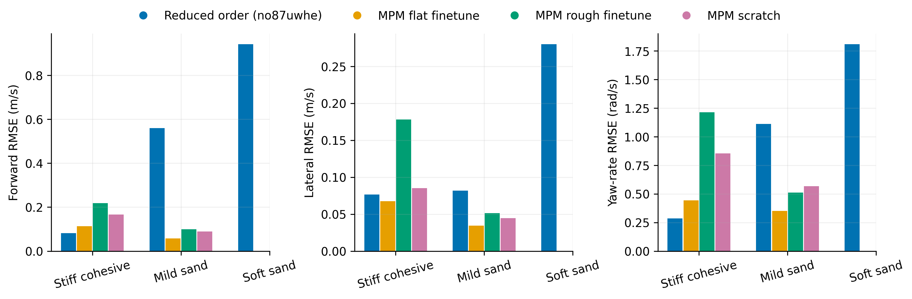
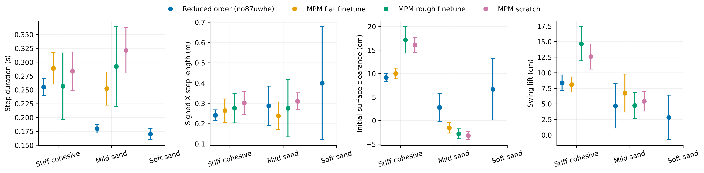
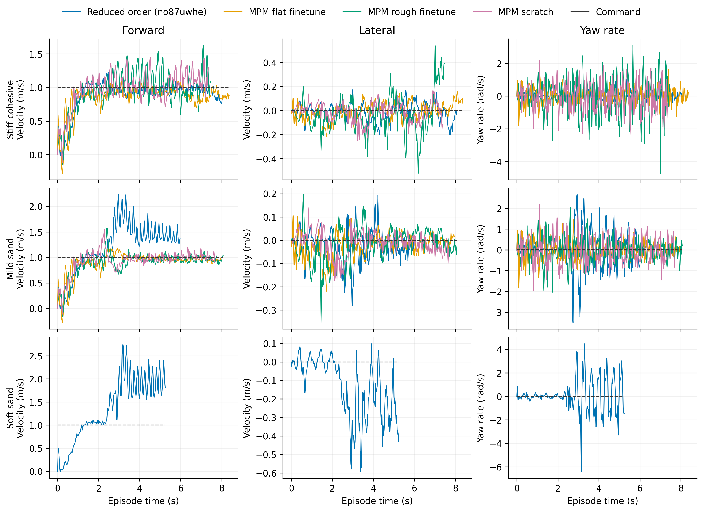

# Flat

Task: `IsaacContrib-Velocity-Sand-Flat-G1-29dof-MPM-Play`

One episode per policy/material, seed 42. Early terminations remain included.

| Material | Policy | Outcome | Duration (s) | Sand window (s) | vx RMSE (m/s) | vy RMSE (m/s) | wz RMSE (rad/s) |
|---|---|---|---:|---:|---:|---:|---:|
| Stiff cohesive | Reduced order (no87uwhe) | crossed sand bed | 8.060 | 5.540 | 0.082 | 0.077 | 0.285 |
| Stiff cohesive | MPM flat finetune | crossed sand bed | 8.380 | 5.760 | 0.114 | 0.068 | 0.444 |
| Stiff cohesive | MPM rough finetune | crossed sand bed | 7.480 | 4.980 | 0.218 | 0.178 | 1.213 |
| Stiff cohesive | MPM scratch | crossed sand bed | 7.380 | 5.020 | 0.166 | 0.085 | 0.854 |
| Mild sand | Reduced order (no87uwhe) | crossed sand bed | 6.000 | 3.580 | 0.560 | 0.082 | 1.111 |
| Mild sand | MPM flat finetune | crossed sand bed | 7.960 | 5.360 | 0.058 | 0.035 | 0.352 |
| Mild sand | MPM rough finetune | crossed sand bed | 8.080 | 5.620 | 0.100 | 0.051 | 0.510 |
| Mild sand | MPM scratch | crossed sand bed | 7.700 | 5.400 | 0.090 | 0.044 | 0.567 |
| Soft sand | Reduced order (no87uwhe) | crossed sand bed | 5.260 | 2.840 | 0.942 | 0.280 | 1.810 |

[Tracking PDF](tracking.pdf)

| Material | Policy | Steps / swings | Step duration (s) | Signed X step length (m) | Clearance (cm) | Swing lift (cm) |
|---|---|---:|---:|---:|---:|---:|
| Stiff cohesive | Reduced order (no87uwhe) | 20 / 20 | 0.255 ± 0.015 | 0.241 ± 0.027 | 9.136 ± 0.832 | 8.380 ± 1.246 |
| Stiff cohesive | MPM flat finetune | 18 / 18 | 0.289 ± 0.028 | 0.264 ± 0.058 | 9.998 ± 1.140 | 8.088 ± 1.202 |
| Stiff cohesive | MPM rough finetune | 18 / 18 | 0.257 ± 0.060 | 0.276 ± 0.072 | 17.151 ± 2.807 | 14.649 ± 2.734 |
| Stiff cohesive | MPM scratch | 17 / 16 | 0.284 ± 0.034 | 0.302 ± 0.056 | 16.081 ± 1.604 | 12.577 ± 2.006 |
| Mild sand | Reduced order (no87uwhe) | 13 / 15 | 0.180 ± 0.008 | 0.288 ± 0.097 | 2.771 ± 2.978 | 4.684 ± 3.566 |
| Mild sand | MPM flat finetune | 18 / 19 | 0.252 ± 0.030 | 0.238 ± 0.068 | -1.576 ± 1.116 | 6.711 ± 3.041 |
| Mild sand | MPM rough finetune | 18 / 17 | 0.292 ± 0.072 | 0.276 ± 0.142 | -2.826 ± 1.053 | 4.730 ± 2.127 |
| Mild sand | MPM scratch | 16 / 16 | 0.321 ± 0.041 | 0.310 ± 0.042 | -3.204 ± 0.869 | 5.413 ± 1.574 |
| Soft sand | Reduced order (no87uwhe) | 2 / 5 | 0.170 ± 0.010 | 0.399 ± 0.279 | 6.658 ± 6.539 | 2.809 ± 3.562 |

[Gait PDF](gait.pdf)

[Traces PDF](traces.pdf)

Gait bars show variation between events in one rollout, not uncertainty across seeds. Clearance uses the initial surface, not the deformed particle surface. Signed X steps can be negative during backward motion and do not measure lateral step length. Missing points mean no complete eligible event.

## Videos

- [basalt_like: 2×2 comparison](../../../videos/four_policy_20261022_v3/flat/comparison_basalt_like.mp4)
  - [Reduced order (no87uwhe)](../../../videos/four_policy_20261022_v3/flat/basalt_like__soft_contact__seed42/rollout.mp4) · [raw data](basalt_like__soft_contact__seed42/trace.npz) · [events](basalt_like__soft_contact__seed42/gait_events.json)
  - [MPM flat finetune](../../../videos/four_policy_20261022_v3/flat/basalt_like__mpm_flat__seed42/rollout.mp4) · [raw data](basalt_like__mpm_flat__seed42/trace.npz) · [events](basalt_like__mpm_flat__seed42/gait_events.json)
  - [MPM rough finetune](../../../videos/four_policy_20261022_v3/flat/basalt_like__mpm_rough__seed42/rollout.mp4) · [raw data](basalt_like__mpm_rough__seed42/trace.npz) · [events](basalt_like__mpm_rough__seed42/gait_events.json)
  - [MPM scratch](../../../videos/four_policy_20261022_v3/flat/basalt_like__scratch__seed42/rollout.mp4) · [raw data](basalt_like__scratch__seed42/trace.npz) · [events](basalt_like__scratch__seed42/gait_events.json)
- [mild_sand: 2×2 comparison](../../../videos/four_policy_20261022_v3/flat/comparison_mild_sand.mp4)
  - [Reduced order (no87uwhe)](../../../videos/four_policy_20261022_v3/flat/mild_sand__soft_contact__seed42/rollout.mp4) · [raw data](mild_sand__soft_contact__seed42/trace.npz) · [events](mild_sand__soft_contact__seed42/gait_events.json)
  - [MPM flat finetune](../../../videos/four_policy_20261022_v3/flat/mild_sand__mpm_flat__seed42/rollout.mp4) · [raw data](mild_sand__mpm_flat__seed42/trace.npz) · [events](mild_sand__mpm_flat__seed42/gait_events.json)
  - [MPM rough finetune](../../../videos/four_policy_20261022_v3/flat/mild_sand__mpm_rough__seed42/rollout.mp4) · [raw data](mild_sand__mpm_rough__seed42/trace.npz) · [events](mild_sand__mpm_rough__seed42/gait_events.json)
  - [MPM scratch](../../../videos/four_policy_20261022_v3/flat/mild_sand__scratch__seed42/rollout.mp4) · [raw data](mild_sand__scratch__seed42/trace.npz) · [events](mild_sand__scratch__seed42/gait_events.json)
- [soft_sand: 2×2 comparison](../../../videos/four_policy_20261022_v3/flat/comparison_soft_sand.mp4)
  - [Reduced order (no87uwhe)](../../../videos/four_policy_20261022_v3/flat/soft_sand__soft_contact__seed42/rollout.mp4) · [raw data](soft_sand__soft_contact__seed42/trace.npz) · [events](soft_sand__soft_contact__seed42/gait_events.json)
  - [MPM flat finetune](../../../videos/four_policy_20261022_v3/flat/soft_sand__mpm_flat__seed42/rollout.mp4) · [raw data](soft_sand__mpm_flat__seed42/trace.npz) · [events](soft_sand__mpm_flat__seed42/gait_events.json)
  - [MPM rough finetune](../../../videos/four_policy_20261022_v3/flat/soft_sand__mpm_rough__seed42/rollout.mp4) · [raw data](soft_sand__mpm_rough__seed42/trace.npz) · [events](soft_sand__mpm_rough__seed42/gait_events.json)
  - [MPM scratch](../../../videos/four_policy_20261022_v3/flat/soft_sand__scratch__seed42/rollout.mp4) · [raw data](soft_sand__scratch__seed42/trace.npz) · [events](soft_sand__scratch__seed42/gait_events.json)
