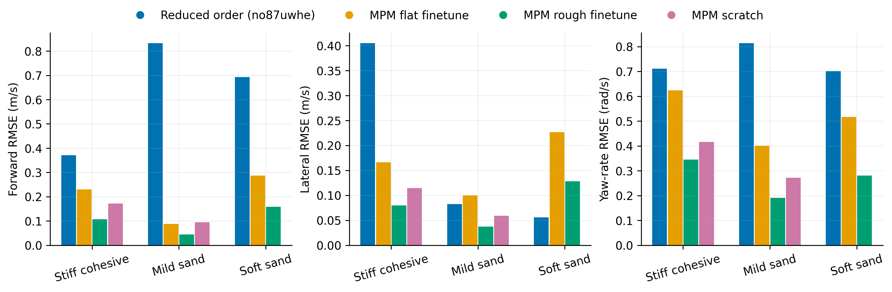
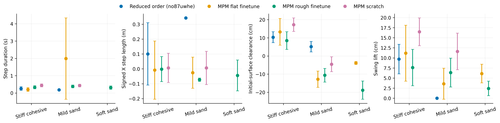
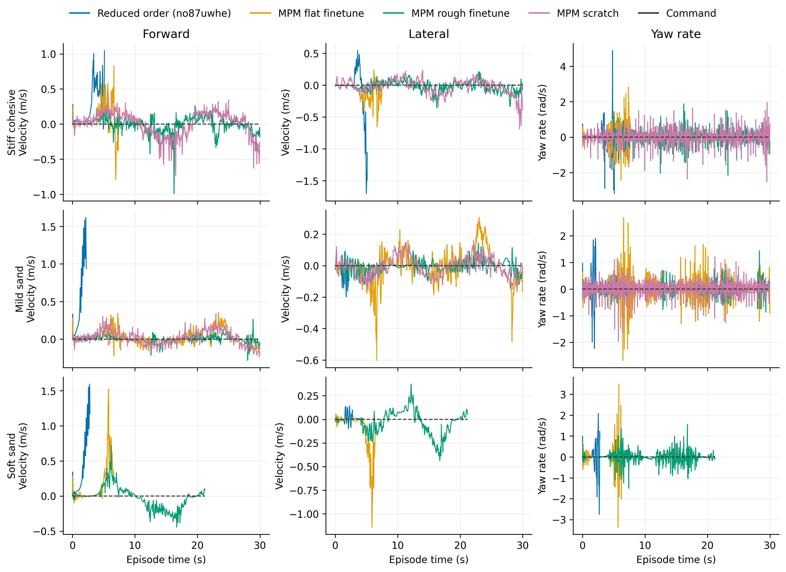

# Standing Tilt

Task: `IsaacContrib-Balance-Sand-Tilting-G1-29dof-MPM-Play`

One episode per policy/material, seed 42. Early terminations remain included.

| Material | Policy | Outcome | Duration (s) | Sand window (s) | vx RMSE (m/s) | vy RMSE (m/s) | wz RMSE (rad/s) |
|---|---|---|---:|---:|---:|---:|---:|
| Stiff cohesive | Reduced order (no87uwhe) | Stopped: bad_orientation | 5.140 | 4.640 | 0.371 | 0.405 | 0.711 |
| Stiff cohesive | MPM flat finetune | Stopped: outside_workspace | 7.740 | 7.240 | 0.230 | 0.166 | 0.624 |
| Stiff cohesive | MPM rough finetune | time limit | 30.000 | 29.500 | 0.106 | 0.080 | 0.345 |
| Stiff cohesive | MPM scratch | time limit | 30.000 | 29.500 | 0.171 | 0.115 | 0.416 |
| Mild sand | Reduced order (no87uwhe) | Stopped: outside_workspace | 2.240 | 1.740 | 0.833 | 0.082 | 0.814 |
| Mild sand | MPM flat finetune | time limit | 30.000 | 29.500 | 0.088 | 0.100 | 0.400 |
| Mild sand | MPM rough finetune | time limit | 30.000 | 29.500 | 0.044 | 0.038 | 0.191 |
| Mild sand | MPM scratch | time limit | 30.000 | 29.500 | 0.095 | 0.059 | 0.271 |
| Soft sand | Reduced order (no87uwhe) | Stopped: outside_workspace | 2.820 | 2.320 | 0.692 | 0.056 | 0.702 |
| Soft sand | MPM flat finetune | Stopped: outside_workspace | 6.640 | 5.440 | 0.287 | 0.227 | 0.517 |
| Soft sand | MPM rough finetune | Stopped: outside_workspace | 21.220 | 20.720 | 0.158 | 0.128 | 0.280 |

[Tracking PDF](tracking.pdf)

| Material | Policy | Steps / swings | Step duration (s) | Signed X step length (m) | Clearance (cm) | Swing lift (cm) |
|---|---|---:|---:|---:|---:|---:|
| Stiff cohesive | Reduced order (no87uwhe) | 5 / 7 | 0.256 ± 0.102 | 0.101 ± 0.209 | 10.340 ± 2.994 | 9.713 ± 3.656 |
| Stiff cohesive | MPM flat finetune | 15 / 17 | 0.203 ± 0.106 | -0.008 ± 0.196 | 13.294 ± 7.342 | 11.168 ± 6.937 |
| Stiff cohesive | MPM rough finetune | 64 / 71 | 0.329 ± 0.090 | -0.002 ± 0.084 | 8.504 ± 4.839 | 7.591 ± 4.511 |
| Stiff cohesive | MPM scratch | 66 / 66 | 0.439 ± 0.089 | 0.006 ± 0.098 | 17.247 ± 3.726 | 16.471 ± 3.450 |
| Mild sand | Reduced order (no87uwhe) | 1 / 2 | 0.180 ± 0.000 | 0.342 ± 0.000 | 5.124 ± 2.878 | 0.000 ± 0.000 |
| Mild sand | MPM flat finetune | 10 / 16 | 1.988 ± 2.347 | -0.026 ± 0.104 | -12.818 ± 4.454 | 3.588 ± 3.843 |
| Mild sand | MPM rough finetune | 2 / 5 | 0.380 ± 0.080 | -0.073 ± 0.011 | -10.626 ± 3.757 | 6.359 ± 3.576 |
| Mild sand | MPM scratch | 64 / 67 | 0.432 ± 0.076 | 0.006 ± 0.112 | -4.544 ± 4.094 | 11.608 ± 4.541 |
| Soft sand | Reduced order (no87uwhe) | 0 / 0 | — | — | — | — |
| Soft sand | MPM flat finetune | 0 / 2 | — | — | -3.864 ± 0.834 | 6.114 ± 2.318 |
| Soft sand | MPM rough finetune | 13 / 16 | 0.312 ± 0.096 | -0.044 ± 0.104 | -18.834 ± 5.010 | 2.418 ± 1.801 |

[Gait PDF](gait.pdf)

[Traces PDF](traces.pdf)

Gait bars show variation between events in one rollout, not uncertainty across seeds. Clearance uses the initial surface, not the deformed particle surface. Signed X steps can be negative during backward motion and do not measure lateral step length. Missing points mean no complete eligible event.

## Videos

- [basalt_like: 2×2 comparison](../../../videos/four_policy_20261022_v3/standing_tilt/comparison_basalt_like.mp4)
  - [Reduced order (no87uwhe)](../../../videos/four_policy_20261022_v3/standing_tilt/basalt_like__soft_contact__seed42/rollout.mp4) · [raw data](basalt_like__soft_contact__seed42/trace.npz) · [events](basalt_like__soft_contact__seed42/gait_events.json)
  - [MPM flat finetune](../../../videos/four_policy_20261022_v3/standing_tilt/basalt_like__mpm_flat__seed42/rollout.mp4) · [raw data](basalt_like__mpm_flat__seed42/trace.npz) · [events](basalt_like__mpm_flat__seed42/gait_events.json)
  - [MPM rough finetune](../../../videos/four_policy_20261022_v3/standing_tilt/basalt_like__mpm_rough__seed42/rollout.mp4) · [raw data](basalt_like__mpm_rough__seed42/trace.npz) · [events](basalt_like__mpm_rough__seed42/gait_events.json)
  - [MPM scratch](../../../videos/four_policy_20261022_v3/standing_tilt/basalt_like__scratch__seed42/rollout.mp4) · [raw data](basalt_like__scratch__seed42/trace.npz) · [events](basalt_like__scratch__seed42/gait_events.json)
- [mild_sand: 2×2 comparison](../../../videos/four_policy_20261022_v3/standing_tilt/comparison_mild_sand.mp4)
  - [Reduced order (no87uwhe)](../../../videos/four_policy_20261022_v3/standing_tilt/mild_sand__soft_contact__seed42/rollout.mp4) · [raw data](mild_sand__soft_contact__seed42/trace.npz) · [events](mild_sand__soft_contact__seed42/gait_events.json)
  - [MPM flat finetune](../../../videos/four_policy_20261022_v3/standing_tilt/mild_sand__mpm_flat__seed42/rollout.mp4) · [raw data](mild_sand__mpm_flat__seed42/trace.npz) · [events](mild_sand__mpm_flat__seed42/gait_events.json)
  - [MPM rough finetune](../../../videos/four_policy_20261022_v3/standing_tilt/mild_sand__mpm_rough__seed42/rollout.mp4) · [raw data](mild_sand__mpm_rough__seed42/trace.npz) · [events](mild_sand__mpm_rough__seed42/gait_events.json)
  - [MPM scratch](../../../videos/four_policy_20261022_v3/standing_tilt/mild_sand__scratch__seed42/rollout.mp4) · [raw data](mild_sand__scratch__seed42/trace.npz) · [events](mild_sand__scratch__seed42/gait_events.json)
- [soft_sand: 2×2 comparison](../../../videos/four_policy_20261022_v3/standing_tilt/comparison_soft_sand.mp4)
  - [Reduced order (no87uwhe)](../../../videos/four_policy_20261022_v3/standing_tilt/soft_sand__soft_contact__seed42/rollout.mp4) · [raw data](soft_sand__soft_contact__seed42/trace.npz) · [events](soft_sand__soft_contact__seed42/gait_events.json)
  - [MPM flat finetune](../../../videos/four_policy_20261022_v3/standing_tilt/soft_sand__mpm_flat__seed42/rollout.mp4) · [raw data](soft_sand__mpm_flat__seed42/trace.npz) · [events](soft_sand__mpm_flat__seed42/gait_events.json)
  - [MPM rough finetune](../../../videos/four_policy_20261022_v3/standing_tilt/soft_sand__mpm_rough__seed42/rollout.mp4) · [raw data](soft_sand__mpm_rough__seed42/trace.npz) · [events](soft_sand__mpm_rough__seed42/gait_events.json)
  - [MPM scratch](../../../videos/four_policy_20261022_v3/standing_tilt/soft_sand__scratch__seed42/rollout.mp4) · [raw data](soft_sand__scratch__seed42/trace.npz) · [events](soft_sand__scratch__seed42/gait_events.json)
